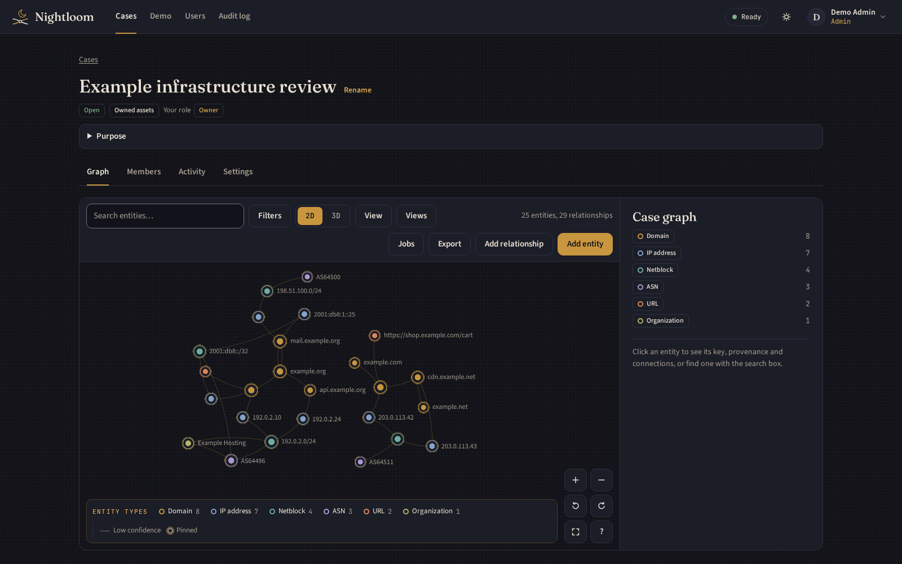
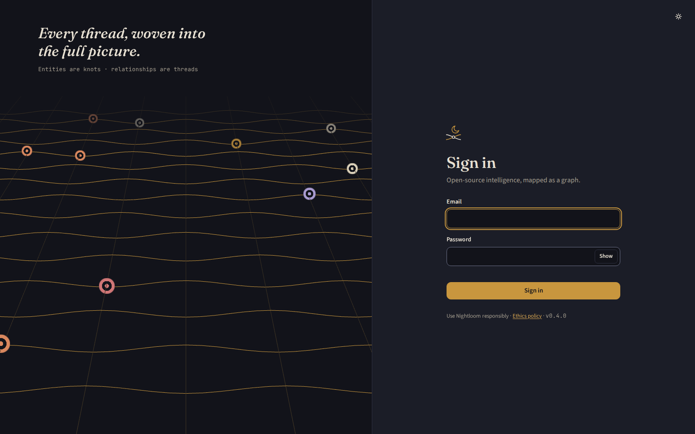
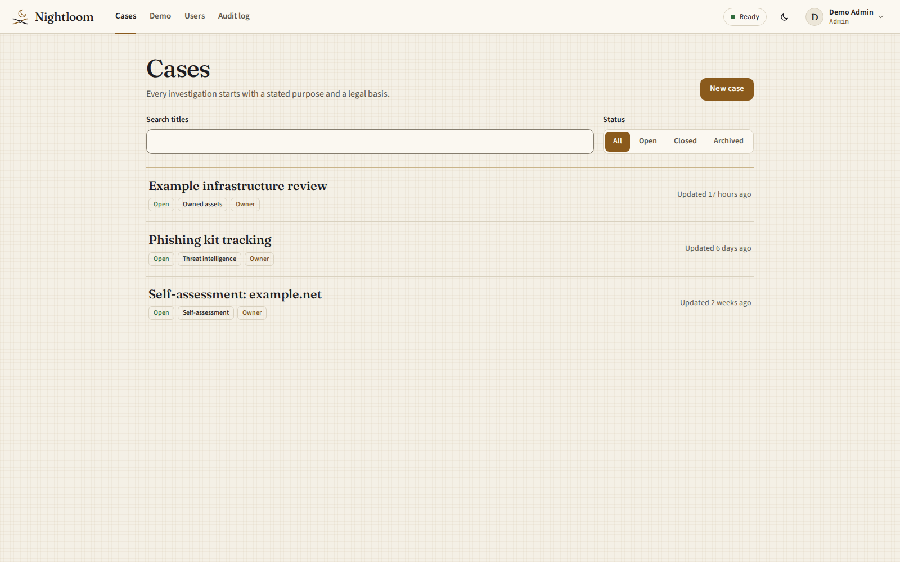
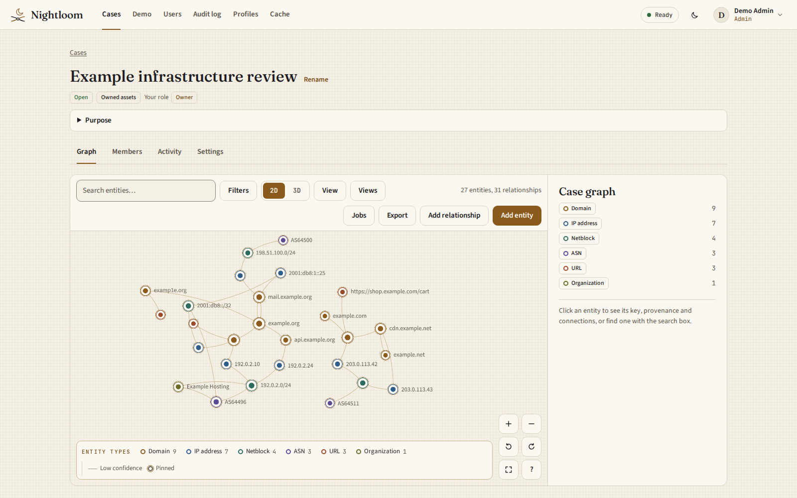
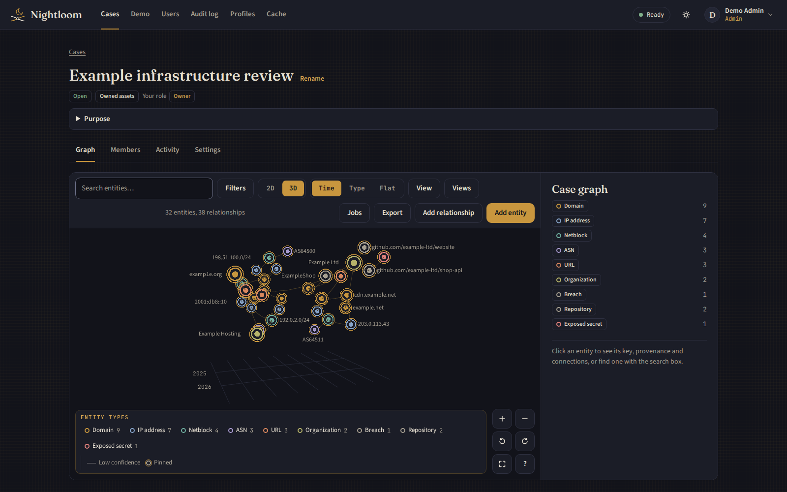
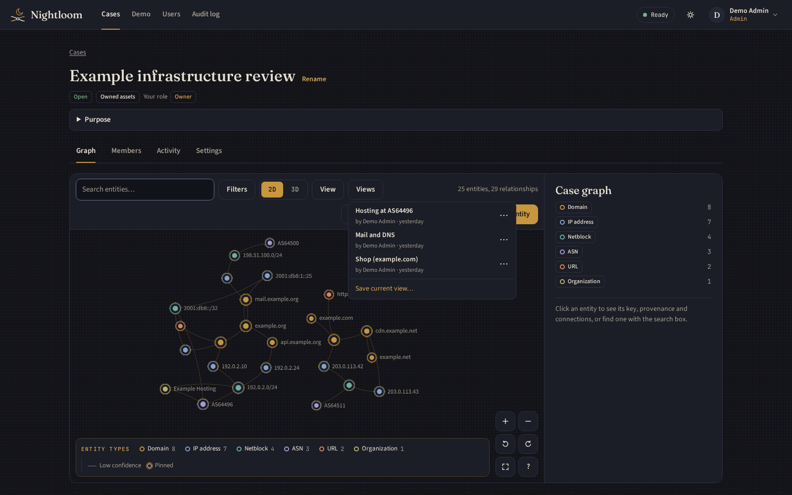
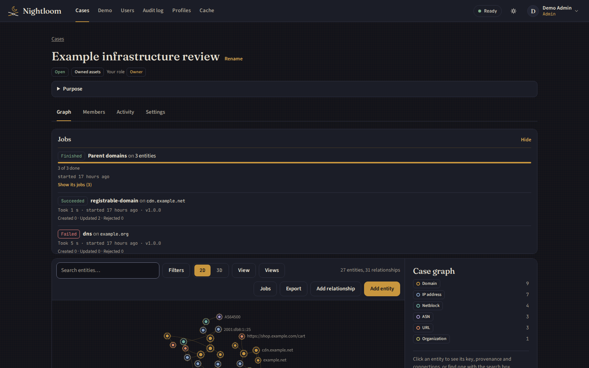

# Nightloom

[](https://github.com/TheRealNightmare/nightloom/releases/latest)
[](LICENSE)
[](https://github.com/TheRealNightmare/nightloom/actions/workflows/ci.yml)

**Every thread, woven into the full picture.**



Nightloom is an open-source, self-hosted OSINT tool that collects **public** information and maps it as an interactive investigation graph. Start from a domain, IP address, organization or other entity, let Nightloom pivot through public data sources, and explore how everything connects — with provenance, evidence and an audit trail for every finding.

> **Status: 0.1.0, the first release.** Cases, the investigation graph, eight passive Shuttles, user management, the audit log and production deployment work today, and `main` adds scan profiles, a result cache, auto-pivot, ownership verification and the first active Shuttles; the other [planned features](#planned-features) do not exist yet. See the [changelog](CHANGELOG.md) and the [roadmap](docs/ROADMAP.md).

## The interface

The web UI has sign-in, **investigation cases** (purpose, legal basis, members, activity) with an interactive graph that Shuttles fill with public data, user management and the audit log for admins, and a separate **demo graph** with fictional `example.org` data, clearly labelled "Demo data".

Its look is called *Loom & thread*: calm and crafted, ink and paper with a brass thread. Entities are knots and relationships are threads. Depth comes from fine hairlines and surface steps rather than shadows or glows; headings are set in Fraunces, the interface in Source Sans 3 and keys, IDs and timestamps in JetBrains Mono, all served by Nightloom itself. There is a light and a dark theme: the system setting is followed until you pick one with the toggle in the top bar.

The sign-in page shows a slow 3D loom beside the form: a brass weft passing over and under the warp threads, knots forming where it crosses. It loads only once the form is ready and the browser is idle, never takes focus, and gives way to a still drawing of the same loom with reduced motion, Save-Data, or without WebGL. Every page has its own title ("Cases · Nightloom"), and Nightloom can be installed as an app from the browser (it has a web manifest and icons).

### Screenshots

All data in these pictures is fictional (`example.org`, documentation IP ranges and AS numbers); `make screenshots` takes them again on a throwaway stack of its own.

| | |
| --- | --- |
|  |  |
| Sign-in (dark) | Cases (light) |
|  |  |
| Graph, 2D (light) | Graph, 3D with depth by time (dark) |
|  |  |
| Saved views | Jobs |

## Quick deploy

Each release publishes multi-architecture images (`linux/amd64`, `linux/arm64`) to GitHub Container Registry, `ghcr.io/therealnightmare/nightloom-backend` and `ghcr.io/therealnightmare/nightloom-web`, so a server only downloads them. On a Linux server with Docker and a DNS name pointing at it:

```sh
git clone --branch v0.1.0 https://github.com/TheRealNightmare/nightloom.git && cd nightloom
make secrets ARGS="--domain nightloom.example.org --acme-email you@example.org"
make deploy-pull && make up
make create-admin email=you@example.org name="Your Name"
```

[docs/DEPLOYMENT.md](docs/DEPLOYMENT.md) covers the requirements, HTTPS with Caddy or Cloudflare Tunnel, backups, upgrades and Raspberry Pi hosts. Releases are listed on the [releases page](https://github.com/TheRealNightmare/nightloom/releases) and in the [changelog](CHANGELOG.md).

## Quick start (developers)

With [uv](https://docs.astral.sh/uv/), [Node.js](https://nodejs.org/) 26 LTS (with [Corepack](https://github.com/nodejs/corepack) for pnpm) and `make` installed:

```sh
make install       # install the Python dependencies
make web-install   # install the web dependencies (pnpm)
make deps-up       # start PostgreSQL, Valkey and Neo4j (Docker), needed by the tests
make check-all     # lint, type-check and test everything
make api           # run the API at http://127.0.0.1:8000/api/docs
make web-dev       # in a second terminal: the UI at http://127.0.0.1:5173
```

With [Docker](https://docs.docker.com/get-started/get-docker/) and Docker Compose you can run the whole stack (web UI, API, PostgreSQL, Neo4j, Valkey and S3-compatible object storage):

```sh
cp .env.example .env   # then change the passwords
make up                # start everything (waits until healthy)
make create-admin email=you@example.org name="Your Name"   # first admin; prompts for a password
```

Then open <http://127.0.0.1:8080> and sign in with the admin you just created.

To run Nightloom on a server with HTTPS, generated secrets and backups, follow [docs/DEPLOYMENT.md](docs/DEPLOYMENT.md).

There is no public sign-up: the first admin is created from the command line, and admins add everyone else on the *Users* page.

See [CONTRIBUTING.md](CONTRIBUTING.md#development-setup) for the full development setup and [Running the stack](CONTRIBUTING.md#running-the-stack).

## Using Nightloom

1. **Sign in** at <http://127.0.0.1:8080> with an account an admin created for you. The first time, you sign in with the temporary password the admin gave you and must choose your own password (12–128 characters) before anything else opens.
2. **Create a case** (admins and analysts): *Cases → New case*. Every case needs a **purpose** (30–2,000 characters: why it exists and what question it answers) and a **legal basis** (owned assets, authorized engagement, threat intelligence, journalism, academic research, self-assessment or other), and you confirm that it follows the [ethics policy](ETHICS.md). An *authorized engagement* or *other* basis also needs a note naming the engagement or explaining the basis. Person entities are off by default; turning them on needs a written reason.
3. **Add what you already know.** On the case's *Graph* tab, editors and owners of an open case choose *Add entity*, pick a type (for example *Domain*) and type a value. Nightloom stores it in its canonical form, so `Example.ORG.` and `example.org` are the same entity. *Add relationship* connects two entities with one of the relationship types allowed for that pair. Click an entity to see its key, provenance and connections, or delete it. Person-related types (email, person, phone, …) are only available in cases that allow person entities.
4. **Run Shuttles.** Shuttles collect for you. Add a domain (say `example.org`), click it, and under *Run Shuttle* in the side panel choose **Run DNS records**. The *Jobs* panel opens and shows the job queued, then running, then succeeded (or why it failed), with what it created; you can cancel it while it runs. Running a Shuttle again on the same entity soon after reuses its recent results instead of asking the source again (DNS for an hour, crt.sh, RIPEstat and InternetDB for a day, RDAP and the Wayback Machine for a week); such a job says *From cache · fetched …*, and *Run fresh* on it (or unticking *Use recent results* before a run) asks the source again. See [The result cache](docs/ARCHITECTURE.md#the-result-cache). **Run a profile** (above *Run a Shuttle*, or in the side panel after selecting several entities with Ctrl/⌘+click or Shift+drag) runs several Shuttles at once: *Quick domain recon*, *Deep domain recon*, *IP / network context*, *Exposure check*, or a profile an admin added on the *Profiles* page. The run queues its jobs a few at a time, within your limit of five, and the *Jobs* panel shows its progress (*7 of 12 done · 2 running · 3 waiting*), its jobs and *Cancel run*. See [Scan profiles and runs](docs/ARCHITECTURE.md#scan-profiles-and-runs). Where a case owner has turned on **Allow auto-pivot** in the case's *Settings*, **Pivot from here** next to *Run on …* runs the profile, then runs it again on the domains, addresses and other infrastructure it finds: up to 2 hops, 200 jobs and 500 new entities, never through people or organizations. See [Auto-pivot](docs/ARCHITECTURE.md#auto-pivot). Active Shuttles (which touch the target itself) only run on domains a case owner has verified in *Settings → Verified domains* with a DNS TXT record or a file on the website, their subdomains and the addresses they resolve to; see [Ownership verification](docs/ARCHITECTURE.md#ownership-verification). On a verified domain, **Run Web server headers and TLS** records which security headers the site sends, its server software, TLS version and certificate; on one of its addresses, **Run Common open ports** tries 20 common TCP ports, four at a time, and adds the open ones as Services; see [The active Shuttles](docs/ARCHITECTURE.md#the-active-shuttles). The graph then reloads with the domain's IP addresses, name servers, mail exchangers and CNAME aliases, highlighted for a moment, and the domain's TXT, SPF, DMARC, SOA and CAA records appear under *Properties*. The DNS Shuttle only asks public resolvers (Cloudflare and Quad9 by default, `NIGHTLOOM_DNS_RESOLVERS`), never your server's own, and refuses internal names such as `printer.local`; see [The DNS Shuttle](docs/ARCHITECTURE.md#the-dns-shuttle). **Run Certificate Transparency (crt.sh)** on the same domain adds the subdomains public TLS certificates were issued for and the most recent certificates, with `COVERS` links to the names they cover; it can take a few minutes for a large domain, and its job shows notes such as how many names it dropped (email addresses, IP addresses, names outside the domain). See [The crt.sh Shuttle](docs/ARCHITECTURE.md#the-crtsh-shuttle). **Run Registration data (RDAP)** adds the domain's registration and expiry dates, status and registrar under *Properties*, with the registrar (and an organization registrant) linked by `REGISTERED_BY`; on an IP address it adds the registered network (`WITHIN`) and the organization that `OWNS` it. It never keeps people's names, email addresses, phone numbers or postal addresses; see [The RDAP Shuttle](docs/ARCHITECTURE.md#the-rdap-shuttle). **Run Routing and ASN (RIPEstat)** on an IP address adds the announced prefix that covers it (`WITHIN`), the ASes that originate it (`ANNOUNCED_BY`) and the organizations that hold them (`OWNS`); on an ASN it adds the prefixes it announces. The holder organization is the same node as RDAP's when both name it the same way; see [The RIPEstat Shuttle](docs/ARCHITECTURE.md#the-ripestat-shuttle). **Run Open ports and exposures (Shodan InternetDB)** on a public IPv4 address adds the ports Shodan's scans found open as Services (`RUNS_ON`), the hostnames it saw as Domains (`RESOLVES_TO`, rated lower because they may be stale), and the software (CPEs), known vulnerabilities (CVE IDs) and tags under *Properties*. It reads Shodan's data and never contacts the address. InternetDB is free for non-commercial use only; the *Run Shuttle* panel shows that condition. See [The InternetDB Shuttle](docs/ARCHITECTURE.md#the-internetdb-shuttle). **Run Reverse DNS (PTR)** on a public address (or a netblock of up to 256 addresses) adds the names its PTR records give as Domains (`HAS_PTR`); a name that resolves back to the address also gets `RESOLVES_TO` and a higher rating, and the relationship's note says whether it was forward-confirmed. See [The reverse DNS Shuttle](docs/ARCHITECTURE.md#the-reverse-dns-shuttle).
5. **Narrow the view.** *Filters* (on the graph) keeps only some entities: data sources (added by hand, or each Shuttle by name), sensitivity, when they were seen (last 24 hours, 7 or 30 days, or a range of dates), minimum confidence, minimum Admiralty reliability (A–E) and credibility (1–5), *focus* (only what is one to three relationships away from the selected entity) and *hide isolated entities*; the legend shows and hides types. A relationship is drawn only when both its ends are. A line such as *Showing 120 of 1,340 entities · 3 filters active* has *Clear all*. Filters are part of the page's address, so a filtered view can be shared as a link and survives a reload. When an entity has more than 25 neighbours of one type that are connected to nothing else (say 312 archived URLs of a domain), they are drawn as one dashed group node (*312 URLs*); click it to expand it, and *Collapse* in the side panel folds it again. Search still finds entities inside a group: picking one expands its group and selects it.
6. **Export.** *Export* (on the graph) downloads the case as JSON (everything, with provenance), GraphML (for Gephi, yEd or Cytoscape) or CSV (a ZIP with `entities.csv`, `relationships.csv` and a README). Any member may export. Person-related data is **redacted by default**: people, email addresses and the other person-related types keep their type, but their values become `[redacted]` and their keys pseudonyms that still connect their relationships. Case owners can include person-related data by giving a reason, which is recorded in the case's activity. Exports are limited to 100,000 entities and to 10 per user every 10 minutes; see [Exports](docs/ARCHITECTURE.md#exports).
7. **Work in the case.** Owners add colleagues by email as owner, editor or viewer (*Members*), editors and owners see who did what (*Activity*), and owners change the purpose or legal basis (which asks for a reason) and close, archive or delete the case (*Settings*).

### Saved views

A saved view is a named snapshot of how a case's graph looks: the camera (position, zoom and rotation), the filters, the expanded groups and the pinned entities. *Views* on the graph toolbar (or <kbd>V</kbd> with the graph focused) lists the case's views with who saved them and when; *Apply* shows one. Applying replaces your own pins with the view's (they become your layout), sets its filters and moves the camera there; *Undo* in the message that follows brings back what you had. Entities the case no longer has are skipped.

Editors and owners of an open case save the current view (*Save current view…*, a name of up to 80 characters, unique in the case) and a view's creator or an owner can *Update with current view*, *Rename* or *Delete* it from its *⋯* menu. *Copy link* copies an address that opens the case graph with the view applied (`…/graph?view=<id>`); it works for every member of the case, viewers included. A case has at most 50 views.

Only members can see a case, admins included. The rules are described in [Cases](docs/ARCHITECTURE.md#cases).

### Graph controls

Drag an entity to move it: it stays **pinned** where you drop it (a thin brass ring and a pin by its label), and the automatic layout leaves it there. Your pins are saved for you alone, per case, so viewers can arrange their own view too, also in closed and archived cases. Unpin from the side panel, the entity's menu (right-click or long press) or *View → Unpin all*; the entity then glides back into the layout. Long labels are shortened on the canvas only (a certificate shows its subject's common name, or `c73e72dd…41a3`); the side panel and the search use the full value.

| To | Mouse | Trackpad | Touch | Keyboard (graph focused) |
| --- | --- | --- | --- | --- |
| Select an entity | click | click | tap | <kbd>Tab</kbd> to it, <kbd>Enter</kbd> |
| Add to / remove from the selection | <kbd>Ctrl</kbd>/<kbd>⌘</kbd>+click | <kbd>Ctrl</kbd>/<kbd>⌘</kbd>+click | | |
| Select everything in a rectangle | <kbd>Shift</kbd>+drag on empty space | <kbd>Shift</kbd>+drag | | |
| Move an entity (and pin it) | drag it; dragging a selected entity moves the whole selection | drag it | drag it | <kbd>P</kbd> to pin, then <kbd>Shift</kbd>+arrows (10 px) |
| Pin or unpin | side panel, or right-click → *Pin* / *Unpin* | side panel | long press → *Pin* / *Unpin* | <kbd>P</kbd> |
| Pan | drag empty space | two-finger scroll | one-finger drag | arrow keys |
| Zoom (toward the pointer) | wheel | pinch | pinch | <kbd>+</kbd> / <kbd>−</kbd> |
| Rotate | <kbd>Alt</kbd>+drag or right-drag on empty space; ⟲ / ⟳ buttons (15°) | <kbd>Option</kbd>+drag (macOS); twist (Safari) | two-finger twist | <kbd>Q</kbd> / <kbd>E</kbd> (15°) |
| Reset zoom, position and rotation | *Reset view* button | *Reset view* | *Reset view* | <kbd>0</kbd> |
| Leave the entity, then clear the selection | click empty space | | tap empty space | <kbd>Esc</kbd> |
| Entity menu (pin, select neighbours, hide its type) | right-click | two-finger click | long press | |
| Saved views of the case | *Views* button | | | <kbd>V</kbd> |
| All shortcuts | *?* button | | | <kbd>?</kbd> |

A trackpad's two-finger scroll pans and a mouse wheel zooms. Browsers do not say which device sent a scroll, so Nightloom guesses from the scroll's shape; if it guesses wrong for your device, choose *View → Scroll wheel → Zoom* or *Pan*. *View → Minimap* shows an overview in the bottom-right corner (on by default above 60 entities): click or drag in it to move there. Keyboard focus moves through the entities in reading order (top-left to bottom-right) and a screen reader hears each one ("Domain www.example.org, 3 neighbours, pinned"); <kbd>Tab</kbd> past the last one leaves the graph.

### The 3D view

*3D* on the graph toolbar shows the same graph in space: the same layout, pins, selection, filters and groups, so switching back and forth keeps your place (the camera looks at the same area). The choice is part of the page's address (`?mode=3d`) and remembered in your browser. Knots and threads keep their 2D look; labels are shown for the hovered, selected and focused entities and for the best-connected ones on screen.

**Depth** (next to the switch) chooses what the third axis shows:

- **Time** (the default): when each entity was first seen, oldest at the back. Entities without a first-seen date sit on a separate *Undated* plane in front. A ruler along the depth axis shows the dates.
- **Type**: one layer per entity type, in the legend's order, named on the ruler.
- **Flat**: no depth: the 2D picture in space.

Changing the depth glides the entities to their new places (at once with reduced motion). Dragging an entity in 3D moves it on the plane facing you and pins it, through the same pins as 2D; its depth always follows the depth mode.

| To | Mouse | Trackpad | Touch | Keyboard (graph focused) |
| --- | --- | --- | --- | --- |
| Select an entity | click | click | tap | <kbd>Tab</kbd> to it (nearest first), <kbd>Enter</kbd> |
| Fly to an entity | double-click | double-click | | <kbd>Enter</kbd> (also selects it) |
| Add to / remove from the selection | <kbd>Ctrl</kbd>/<kbd>⌘</kbd>+click | <kbd>Ctrl</kbd>/<kbd>⌘</kbd>+click | | |
| Select everything in a rectangle | <kbd>Shift</kbd>+drag | <kbd>Shift</kbd>+drag | | |
| Move an entity (and pin it) | drag it (a selected one moves the selection) | drag it | drag it | |
| Pin or unpin | side panel, or right-click → *Pin* / *Unpin* | side panel | long press | <kbd>P</kbd> |
| Orbit around the graph | drag empty space | drag | one-finger drag | arrow keys (10°) |
| Pan | right-drag | two-finger scroll | two-finger drag | <kbd>Shift</kbd>+arrows |
| Zoom (toward the pointer) | wheel | pinch | pinch | <kbd>+</kbd> / <kbd>−</kbd> |
| Turn around the vertical axis | ⟲ / ⟳ buttons (15°) | | | <kbd>Q</kbd> / <kbd>E</kbd> (15°) |
| Frame the whole graph | *Reset view* button | | | <kbd>0</kbd> |
| Entity menu, saved views, shortcuts | right-click; *Views*; *?* | | long press | <kbd>V</kbd>; <kbd>?</kbd> |

*View → Scroll wheel* and *View → Minimap* work in 3D too; the minimap shows the graph from the top with the camera's view as a brass outline. The 3D view needs WebGL 2; where it is not available (or the graphics driver resets it) the graph is shown in 2D with a short notice, and 3D comes back by itself once WebGL is restored. Saved views remember 2D or 3D, the 3D camera and the depth.

**Managing users (admins).** *Users* in the top bar lists every account with its role, status, last sign-in and creation date, with a search and role and status filters. *New user* asks for an email, a display name and a role (admin, analyst or viewer); Nightloom generates a temporary password and shows it **once**, with a copy button. Pass it on through a secure channel (not the same email or chat as the address); the user must replace it when they first sign in. On each row you can change the role, deactivate or reactivate the account (deactivating signs the user out everywhere; nobody can remove the last active admin or their own admin role), sign the user out everywhere (*Revoke sessions*), or *Reset password*, which ends all their sessions and shows a new temporary password once. You change your own password from the account menu instead. *Audit log* in the top bar shows every recorded action, newest first, filtered by action, outcome, actor, case ID or dates (UTC); *Details* shows an event's full record, and *Verify chain* checks that no event was changed or removed. See [Authentication](docs/ARCHITECTURE.md#authentication) and [Audit log](docs/ARCHITECTURE.md#audit-log).

### Available Shuttles

| Shuttle | Input | What it does |
| --- | --- | --- |
| `registrable-domain` | Domain | Links a subdomain to its registrable domain (`www.shop.example.co.uk` → `example.co.uk`) using the bundled Public Suffix List; no network. |
| `dns` | Domain | Looks up the domain's public DNS records (A, AAAA, CNAME, MX, NS, TXT, SOA, CAA, DMARC) through public resolvers only. |
| `crtsh` | Domain | Finds subdomains and recent TLS certificates in Certificate Transparency logs via crt.sh (no API key); drops names outside the domain, email addresses and IP addresses. |
| `rdap` | Domain, IP address, Netblock, ASN | Looks up public registration data (RDAP) at the responsible registry, found through IANA's bootstrap registries (no API key): a domain's dates, status, registrar, organization registrant and name servers; an address's or netblock's registered network and owner; an ASN's registration and owner. Keeps only organization names, never contact details. |
| `ripestat` | IP address, Netblock, ASN | Looks up routing data in the RIPE NCC's RIPEstat (no API key): the announced prefix covering an address and its origin ASes; whether a netblock is announced, by whom, and the covering prefix; an ASN's holder and the prefixes it announces (at most 500). AS holders become Organizations. |
| `internetdb` | IP address (public IPv4) | Looks up what Shodan's scans saw on the address in Shodan's InternetDB (no API key): open ports as Services, hostnames as Domains, and CPEs, CVE IDs and tags as properties. Never contacts the address. **Free for non-commercial use only**; a paid product built on this data needs a Shodan license. |
| `reverse-dns` | IP address, Netblock (up to 256 addresses) | Looks up the PTR (reverse DNS) names of a public address, or of every address in a netblock of at most 256 addresses (IPv4 /24, IPv6 /120), through the same public resolvers as `dns`. Each name is checked against forward DNS: one that resolves back to the address gets `RESOLVES_TO` and a higher rating; one that does not is kept lower-rated with a note, since anyone controlling the reverse zone can set any name. Private addresses are skipped. |
| `wayback` | Domain | Lists the pages of the domain and its subdomains that the Internet Archive's Wayback Machine has captured (no API key): URLs with their first capture, last status and a link to the archived copy, and the subdomains that host them. Never contacts the domain. Leaves out other domains and static assets, removes query strings (keeping only parameter names) and drops addresses containing an email address. |

All eight are passive. `rdap` and `ripestat` add Organizations, so they have the `organization` sensitivity; the others are infrastructure-only. None handles person-related types. `make shuttles` lists what is installed.

## Planned features

- **Graph investigations** — entities and relationships stored in Neo4j and explored in a React + Sigma.js graph UI.
- **Shuttles** — a plugin system; each Shuttle queries one data source and turns results into entities and links.
- **Timeline, change diffs and scheduled monitoring** — see what changed and when.
- **AI analyst** — bring your own API key for any provider via LiteLLM. Keys belong to each user only; local models via Ollama are supported.
- **Ariadne's Thread** — find how two entities are connected.
- **Evidence capture** — stored artifacts with cryptographic hashes.
- **Patterns** — reusable investigation playbooks.
- **Import/export** — STIX 2.1, GraphML, MISP, PDF.

## Planned tech stack

| Layer | Technology |
| --- | --- |
| API | Python 3.12, FastAPI |
| Background jobs | Celery + Valkey (Redis-compatible) |
| Graph store | Neo4j |
| Relational store | PostgreSQL (users, cases, jobs, audit log) |
| Evidence files | S3-compatible object storage (SeaweedFS by default) |
| Web UI | React, Vite, TypeScript, Sigma.js |
| Self-hosting | Docker Compose |

## Planned repository layout

```text
apps/
  api/        FastAPI backend
  worker/     Celery workers
  web/        React frontend
packages/
  sdk/        Shuttle SDK
shuttles/     Built-in Shuttles (plugins)
deploy/       Docker Compose stack
docs/         Documentation
```

## Documentation

- [Deployment](docs/DEPLOYMENT.md)
- [Changelog](CHANGELOG.md)
- [Releasing](docs/RELEASING.md)
- [Architecture](docs/ARCHITECTURE.md)
- [Roadmap](docs/ROADMAP.md)
- [Ethics and acceptable use](ETHICS.md)
- [Contributing](CONTRIBUTING.md)
- [Security policy](SECURITY.md)
- [Code of conduct](CODE_OF_CONDUCT.md)

## Responsible use

Nightloom is for lawful investigation of **public** information — security research, attack-surface management, journalism and education. It must not be used for stalking, harassment, doxxing or bypassing access controls. Read [ETHICS.md](ETHICS.md) before using or contributing.

## License

Licensed under the [Apache License, Version 2.0](LICENSE). See [NOTICE](NOTICE).
