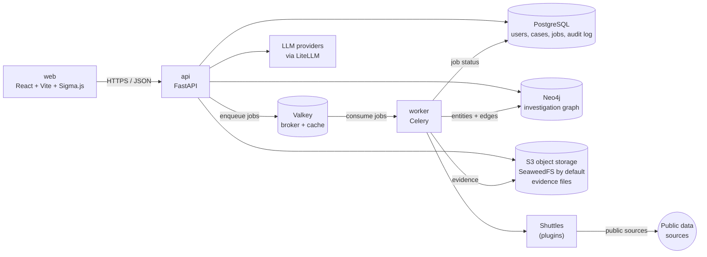

# Architecture

> **Status: planned.** Nothing here is implemented yet. This document describes the intended design and will change as the code lands.

## Components

| Component | Role |
| --- | --- |
| `apps/web` | React UI: graph view, case management, provenance panel |
| `apps/api` | FastAPI: auth, cases, graph queries, job submission, AI endpoints |
| `apps/worker` | Celery workers that run Shuttles and auto-pivot scans |
| `packages/sdk` | Shuttle SDK: base classes, entity types, test helpers |
| `shuttles/` | Built-in Shuttles |
| PostgreSQL | Users, cases, jobs, audit log, encrypted API keys |
| Neo4j | Entities and relationships |
| Valkey (Redis-compatible) | Celery broker, rate-limit counters, result cache |
| S3-compatible object storage (SeaweedFS by default) | Evidence files (screenshots, raw responses, documents) |

### Infrastructure choices

The local stack is defined in [`deploy/compose.yaml`](../deploy/compose.yaml) (see [Running the stack](../CONTRIBUTING.md#running-the-stack)).

- **Object storage is accessed only through the S3 API**, so any S3-compatible service works. The stack ships [SeaweedFS](https://github.com/seaweedfs/seaweedfs) (Apache-2.0) as the default. MinIO was the original plan, but its community edition no longer publishes Docker images and has been archived.
- **Valkey instead of Redis.** [Valkey](https://valkey.io/) is a BSD-licensed, Redis-compatible fork. Redis itself is no longer under a permissive open-source license. Clients talk the Redis protocol, so standard Redis libraries work unchanged.
- **Neo4j Community Edition** (GPLv3) runs as a separate server that Nightloom talks to over Bolt. It is not bundled into Nightloom's code.

### Web UI

[`apps/web`](../apps/web/) is a single-page app built with React, Vite and TypeScript (strict). The graph is a [graphology](https://graphology.github.io/) graph rendered by [Sigma.js](https://www.sigmajs.org/) (WebGL), laid out with ForceAtlas2 for a bounded number of iterations so the page never blocks on layout.

- **Same-origin API.** The UI only calls relative `/api/...` URLs. In development the Vite dev server proxies them to `http://127.0.0.1:8000`; in the Compose stack the `web` container (unprivileged nginx) serves the built files and proxies `/api/` to `http://api:8000`. No CORS configuration is needed.
- **Static hosting.** nginx falls back to `index.html` for client-side routes, caches the content-hashed `/assets/` for a year, revalidates `index.html` on every load, and sends a strict Content Security Policy (same origin only, plus `blob:` for workers and images) with other security headers.
- **API status.** The top bar polls `GET /api/v1/ready` every 15 seconds and shows *Ready*, *Degraded* (listing the failing checks) or *API offline*.
- **Demo data.** Until the graph API exists, the UI shows a typed fixture ([`src/demo/sampleGraph.ts`](../apps/web/src/demo/sampleGraph.ts)) shaped like the [data model](#data-model): entity types and provenance fields on every node and edge. It is entirely fictional (`example.org`, RFC 5737 IP addresses, RFC 5398 AS numbers, no people) and labelled "Demo data" in the UI.
- **Testable without WebGL.** Highlighting, filtering and search are pure functions over the graph; sigma only applies their results through its node and edge reducers.

### Health and readiness

The API creates its clients (async SQLAlchemy engine, Neo4j driver, Valkey client, S3 client) in the FastAPI lifespan, but none of them connects at startup. The API therefore always starts, even when every dependency is down.

| Endpoint | Kind | Behaviour |
| --- | --- | --- |
| `GET /api/v1/health` | Liveness | Always `200` while the process is serving requests. Never touches a dependency. |
| `GET /api/v1/ready` | Readiness | Pings PostgreSQL (`SELECT 1`), Neo4j (`RETURN 1`), Valkey (`PING`) and object storage (`HeadBucket` on the evidence bucket) concurrently, each limited to `NIGHTLOOM_DEPENDENCY_TIMEOUT_SECONDS` (default 2). `200` when all pass, `503` otherwise. |

The readiness body reports `ok`, `latency_ms` and a short `error` for each dependency. Errors are redacted before they are returned or logged: they never include credentials or connection URLs. Use `/health` for container restarts and `/ready` for traffic routing and monitoring.

### Migrations

The PostgreSQL schema is managed by [Alembic](https://alembic.sqlalchemy.org/) in [`apps/api/alembic/`](../apps/api/alembic/). ORM models derive from `nightloom_api.infra.db.Base`, whose metadata has an explicit naming convention, so constraint and index names are stable across autogenerated revisions. The history starts at an empty `0001_baseline` revision. In the Compose stack, a one-shot `migrate` service runs `alembic upgrade head` before the API starts.

## Data model

Entity types are inspired by STIX 2.1:

| Group | Types |
| --- | --- |
| Infrastructure | Domain, Subdomain, IP, ASN, Netblock, Certificate, URL, Port/Service, Technology |
| Organizations and people | Organization, Person, Email, Username, SocialProfile, Phone |
| Other | Breach, Location, Image, Document, CryptoWallet |

### Provenance

Every node **and** edge carries:

| Field | Meaning |
| --- | --- |
| `source` | The Shuttle that produced it |
| `first_seen` / `last_seen` | When it was first and most recently observed |
| `confidence` | 0–1 |
| `admiralty` | Admiralty rating, `A1`–`F6` (source reliability × information credibility) |
| `evidence` | Pointer to the evidence object in S3 object storage |
| `case_id` | The case it belongs to |

### Deduplication

Each entity type defines a **canonical key** (e.g. lower-cased FQDN for a Domain, normalized address for an IP). Writes are upserts on `(case_id, type, canonical_key)`, so the same entity found by several Shuttles becomes one node with multiple provenance records.

## Shuttle contract

A Shuttle is a plugin that takes one entity and returns entities and edges. Each declares:

| Field | Description |
| --- | --- |
| `name` | Unique identifier |
| `input_types` | Entity types it accepts |
| `output_types` | Entity types it can produce |
| `mode` | `passive` (third-party sources only) or `active` (touches the target) |
| `requires_api_key` | Whether a user-supplied key is needed |
| `rate_limit` | Per-source request limit |
| `risk_level` | `infrastructure` or `person` |

Active Shuttles run only against assets with verified ownership. Person-related Shuttles are gated per case and never run during auto-pivot.

## Auto-pivot

Auto-pivot expands a seed entity breadth-first:

- **Max depth** — number of hops from the seed
- **Budget** — maximum requests and/or nodes per scan
- **Entity-type allowlist** — only pivot through selected types
- **Passive-only mode** — skip all active Shuttles
- Person-related Shuttles are always excluded

The scan stops when the queue is empty or any limit is reached; partial results are kept.

## AI layer

- **LiteLLM** provides one interface to any provider, including local models via Ollama.
- **Per-user API keys** — encrypted at rest with AES-GCM, bound to the owning `user_id` (as associated data), decrypted only server-side when needed, and **never sent to the browser**.
- **Per-feature model routing** — each user picks which model handles each feature (e.g. summaries vs. query generation).
- **Natural language → Cypher** — generated queries run as a **read-only** Neo4j user, so the AI can never modify the graph.

## Guardrails

Collection rules, gated Shuttles, audit logging, PII redaction and data retention are defined in [ETHICS.md](../ETHICS.md). They are design requirements, not optional features.
