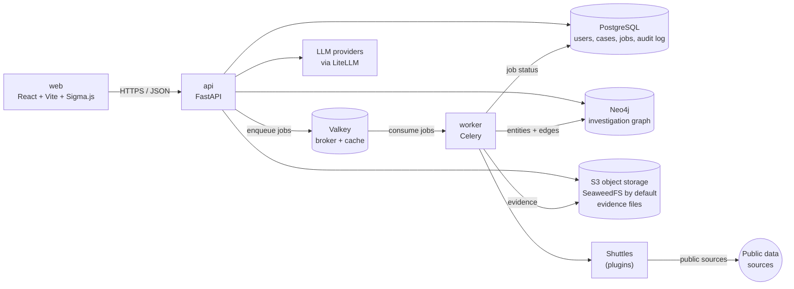

# Architecture

> **Status: planned.** Nothing here is implemented yet. This document describes the intended design and will change as the code lands.

## Components

| Component | Role |
| --- | --- |
| `apps/web` | React UI: graph view, case management, provenance panel |
| `apps/api` | FastAPI: auth, cases, graph queries, job submission, AI endpoints |
| `apps/worker` | Celery workers that run Shuttles and auto-pivot scans |
| `packages/core` | Shared entity model (`nightloom-core`): entity types, canonical keys, relationship allow-list, provenance |
| `packages/sdk` | Shuttle SDK: base classes, test helpers (planned) |
| `shuttles/` | Built-in Shuttles |
| PostgreSQL | Users, cases, jobs, audit log, encrypted API keys |
| Neo4j | Entities and relationships |
| Valkey (Redis-compatible) | Celery broker, rate-limit counters, result cache |
| S3-compatible object storage (SeaweedFS by default) | Evidence files (screenshots, raw responses, documents) |

### Infrastructure choices

The local stack is defined in [`deploy/compose.yaml`](../deploy/compose.yaml) (see [Running the stack](../CONTRIBUTING.md#running-the-stack)).

- **Object storage is accessed only through the S3 API**, so any S3-compatible service works. The stack ships [SeaweedFS](https://github.com/seaweedfs/seaweedfs) (Apache-2.0) as the default. MinIO was the original plan, but its community edition no longer publishes Docker images and has been archived.
- **Valkey instead of Redis.** [Valkey](https://valkey.io/) is a BSD-licensed, Redis-compatible fork. Redis itself is no longer under a permissive open-source license. Clients talk the Redis protocol, so standard Redis libraries work unchanged.
- **Neo4j Community Edition** (GPLv3) runs as a separate server that Nightloom talks to over Bolt. It is not bundled into Nightloom's code.

### Web UI

[`apps/web`](../apps/web/) is a single-page app built with React, Vite and TypeScript (strict). The graph is a [graphology](https://graphology.github.io/) graph rendered by [Sigma.js](https://www.sigmajs.org/) (WebGL), laid out with ForceAtlas2 for a bounded number of iterations so the page never blocks on layout.

- **Same-origin API.** The UI only calls relative `/api/...` URLs. In development the Vite dev server proxies them to `http://127.0.0.1:8000`; in the Compose stack the `web` container (unprivileged nginx) serves the built files and proxies `/api/` to `http://api:8000`. No CORS configuration is needed.
- **Static hosting.** nginx falls back to `index.html` for client-side routes, caches the content-hashed `/assets/` for a year, revalidates `index.html` on every load, and sends a strict Content Security Policy (same origin only, plus `blob:` for workers and images) with other security headers.
- **API status.** Once signed in, the top bar polls `GET /api/v1/ready` every 15 seconds and shows *Ready*, *Degraded* (listing the failing checks) or *API offline*.
- **Sign-in.** See [Web authentication flow](#web-authentication-flow).
- **Routes.** [React Router](https://reactrouter.com/) in data mode ([`src/app/routes.tsx`](../apps/web/src/app/routes.tsx)). Every route sits under the auth gate, so a signed-out visitor sees the sign-in screen at the address they opened and stays there after signing in. nginx serves `index.html` for these paths, so deep links and reloads work.

  | Path | Page |
  | --- | --- |
  | `/` | redirects to `/cases` |
  | `/cases` | your cases: title search (debounced), status filter, *Load more* (keyset cursor); *New case* for admins and analysts |
  | `/cases/new` | create a case: purpose, legal basis (+ note), person entities (+ reason), retention, ethics confirmation; checked locally with the server's rules, and the server's `422` messages are shown on their fields |
  | `/cases/:caseId` | redirects to the `graph` tab; the header shows title (renamed inline by editors and owners), status, legal basis, your role and the purpose |
  | `/cases/:caseId/graph` | the case's graph from the API (never demo data): explore it, and editors of an open case add entities and relationships by hand or delete entities; see [Graph view](#graph-view) |
  | `/cases/:caseId/members` | members; owners add by email, change roles and remove; anyone can leave |
  | `/cases/:caseId/activity` | the case's audit events with readable labels (owners and editors) |
  | `/cases/:caseId/settings` | purpose, legal basis, person entities, retention (a dialog asks for the change reason where the API needs one), close / reopen / archive, delete by typing the title (owners) |
  | `/demo` | the demo graph (loaded on demand, so sigma is not in the main bundle) |
  | anything else | "Page not found" |

  Tabs a role cannot use are hidden, mirroring the API's [capability table](#cases); opening one directly shows "You don't have permission". A case that does not exist and one you are not a member of both show the same "Case not found" page, as the API answers `404` for both.
- **Demo data.** The `/demo` page shows a typed fixture ([`src/demo/sampleGraph.ts`](../apps/web/src/demo/sampleGraph.ts)) using the [data model](#data-model)'s entity types, with provenance on every node and edge. It is entirely fictional (`example.org`, RFC 5737 IP addresses, RFC 5398 AS numbers, no people) and labelled "Demo data" in the top bar. Case graphs never show that badge or any fixture data.
- **Testable without WebGL.** Highlighting, filtering and search are pure functions over the graph; sigma only applies their results through its node and edge reducers.

#### Graph view

The demo and the case *Graph* tab share one component, `GraphView` ([`src/graph/GraphView.tsx`](../apps/web/src/graph/GraphView.tsx)): the sigma canvas, entity search, a type legend that toggles visibility, and a side panel. Callers pass the nodes and edges plus what the side panel shows (an overview, and an entity's details). Entity colors come from one palette ([`src/domain/entities.ts`](../apps/web/src/domain/entities.ts)) that the canvas, legend, search results and chips all use.

- **No duplicated rules.** The web knows entity types only to give them a color and a label. Sensitivity, value hints and examples, the relationship allow-list, the Admiralty scales and the manual-observation defaults come from [`GET /schema`](#schema-endpoint), fetched once per page load.
- **Incremental updates.** `GraphView` keeps one graphology graph for its lifetime and syncs the data into it ([`syncGraph`](../apps/web/src/graph/buildGraph.ts)), removing what is gone, updating what changed and adding what is new. A freshly loaded graph starts on a circle grouped by type and gets a full layout. A node added later is placed at the centre of its neighbours, or just outside the graph when it has none. If it has neighbours, a short layout follows (60 iterations) in which every other node is pinned (ForceAtlas2's `fixed`), so adding an entity never reshuffles the picture. After that layout, the camera moves to the new entity. sigma's camera does not follow a change in the graph's extent, so in a graph of up to 200 nodes it shows the whole graph, with the new entity selected and highlighted. In a larger graph, whose extent barely changes, it zooms to the entity. Graphs of up to 200 nodes also label every node.
- **Layout never blocks.** ForceAtlas2 runs in time slices ([`src/graph/layout.ts`](../apps/web/src/graph/layout.ts)): each slice works for about 12 ms and then yields to the browser, with a hard cap on iterations (300 for a full layout, 150 above 500 nodes where Barnes-Hut is switched on). On a desktop CPU (i5-13400), the synthetic 2,000-entity graph used by [`src/graph/performance.test.ts`](../apps/web/src/graph/performance.test.ts) syncs in about 15 ms and settles in about 1.1 s over 75 slices (median 13 ms, longest 38 ms). Adding one entity to it takes about 3 ms. The generator lives in `src/test/`, which the app never imports, so no synthetic data reaches the production bundle.
- **Loaded on demand.** sigma and graphology are only fetched when there is a graph to draw: `/demo` is a lazy route, and the case Graph tab lazy-loads `GraphView`, so its empty state and forms do not need them.

**Case Graph tab** ([`src/cases/GraphTab.tsx`](../apps/web/src/cases/GraphTab.tsx)). The tab loads `GET /cases/{id}/graph` (limit 2,000) and the schema. Entities become nodes (key as id, value as label) and relationships become edges, carrying their full provenance.

- **Header.** A live summary ("2 entities, 1 relationship"). When the API reports `truncated`, a banner says only the first 2,000 entities by key, with at most five relationships each, are drawn.
- **Side panel.** For the selected entity: type, value, key (with a copy button), sensitivity, neighbour count (from `GET /entities/{key}`, so it is exact even when the view is truncated), first and last seen, observation count, sources, max confidence as a percentage, Admiralty rating (hover or focus explains both grades), evidence references, note, and its connections.
- **Add entity** (editors and owners of an open case). Types are grouped by sensitivity. Person-related types are disabled, with the reason, when the case does not allow person entities. The value field shows the type's hint and example from the schema, and there is an optional note (and a phone region for phone numbers). The server normalizes the value: its `422` message (e.g. *A domain name needs at least two labels*) appears under the field, and a `403` or `409` appears in the form. On success the node appears, selected and in view. Adding something the case already has says so (the API merged an observation).
- **Add relationship.** Pick both ends from the case's entities with a searchable combobox (the selected entity is pre-filled), swap the direction if needed, and choose from only the relationship types the schema allows for that pair. `RELATED_TO` asks for a note.
- **Delete entity.** From the side panel, after a confirmation. Its relationships go too.
- **Read-only.** Viewers, and everyone while the case is closed or archived, see the graph without these controls and a one-line explanation.
- **Empty state.** *No entities yet.* with a hint that automated collection (Shuttles) comes next, and *Add your first entity* for editors.

### Health and readiness

The API creates its clients (async SQLAlchemy engine, Neo4j driver, Valkey client, S3 client) in the FastAPI lifespan, but none of them connects at startup. The API therefore always starts, even when every dependency is down.

| Endpoint | Kind | Behaviour |
| --- | --- | --- |
| `GET /api/v1/health` | Liveness | Always `200` while the process is serving requests. Never touches a dependency. |
| `GET /api/v1/ready` | Readiness | Pings PostgreSQL (`SELECT 1`), Neo4j (`RETURN 1`), Valkey (`PING`) and object storage (`HeadBucket` on the evidence bucket) concurrently, each limited to `NIGHTLOOM_DEPENDENCY_TIMEOUT_SECONDS` (default 2). `200` when all pass, `503` otherwise. |

The readiness body reports `ok`, `latency_ms` and a short `error` for each dependency. Errors are redacted before they are returned or logged: they never include credentials or connection URLs. Use `/health` for container restarts and `/ready` for traffic routing and monitoring.

### Authentication

The API authenticates browsers with **server-side sessions** (code in [`nightloom_api/auth/`](../apps/api/src/nightloom_api/auth/)). There is no public registration: the first admin is created with `make create-admin`, and admins create everyone else.

**Sessions.** A successful `POST /api/v1/auth/login` creates a random 256-bit token (`secrets.token_urlsafe(32)`) and sends it only in the `nightloom_session` cookie: `HttpOnly`, `SameSite=Strict`, `Path=/`, and `Secure` in production (or with `NIGHTLOOM_COOKIE_SECURE=true`). PostgreSQL stores only the token's SHA-256 in the `sessions` table, so a leaked table cannot be replayed. A session expires after **24 hours without use** (sliding; `last_seen_at` is written at most once a minute) and, at the latest, **7 days after sign-in**. Expired sessions are deleted when they are next presented and when their user signs in again. Logging out deletes the row. Changing your password signs out your other sessions; deactivating a user or revoking their sessions (admin) signs them out everywhere.

**CSRF.** Login also sets a non-HttpOnly `nightloom_csrf` cookie. Every authenticated `POST`, `PUT`, `PATCH` or `DELETE` must repeat it in the `X-CSRF-Token` header (double submit, constant-time comparison), or it gets `403`. The CSRF token is derived from the session token with a domain-separated SHA-256, so a cookie planted by an attacker (for example from a sibling subdomain) does not match the victim's session. Login itself is exempt. `SameSite=Strict` is a second, independent layer.

**Passwords.** Hashed with Argon2id ([pwdlib](https://github.com/frankie567/pwdlib) on argon2-cffi, its recommended parameters); a hash with outdated parameters is upgraded on the next successful sign-in. The policy is 12–128 characters, not equal to or containing the local part of the user's email (for local parts of three or more characters). Emails are stored trimmed and lower-case, and are unique.

**Roles.** `admin`, `analyst` and `viewer`. Routes use the `current_user` dependency (`401` without a valid session) and `require_role(...)` (`403`, recorded in the [audit log](#audit-log)). Only admins manage users. An admin cannot demote or deactivate themselves, and the last active admin cannot be demoted or deactivated (`409`); concurrent changes are serialized with row locks.

**Brute-force protection.** Failed sign-ins are counted in Valkey, per email (hashed, so Valkey holds no addresses) and per client IP, in 15-minute windows. After **5 failures for an email** or **20 from an IP**, further attempts get `429` with `Retry-After` until the window ends, without checking the password. A successful sign-in resets the email's counter. Every failure returns the same `401 "Invalid email or password."`, and an unknown email still runs a full Argon2 verification, so neither the message nor the timing reveals whether an account exists. Wrong current passwords on `POST /auth/password` count against the same limits. If Valkey is unreachable, sign-in fails closed with `503`.

| Endpoint (under `/api/v1`) | Who | Notes |
| --- | --- | --- |
| `POST /auth/login` | anyone | `{email, password}` → `{user}` and both cookies |
| `POST /auth/logout` | signed in | `204`, clears the cookies |
| `GET /auth/me` | signed in | the current user |
| `POST /auth/password` | signed in | `{current_password, new_password}` → `204` |
| `GET /users`, `POST /users` | admin | list; create with an initial password |
| `PATCH /users/{id}` | admin | `display_name`, `role`, `is_active` |
| `DELETE /users/{id}/sessions` | admin | sign the user out everywhere |
| `GET /audit` | admin | the [audit log](#audit-log), newest first |
| `POST /audit/verify` | admin | check the audit log's hash chain |

`/health` and `/ready` stay public. Request validation errors (`422`) never echo the submitted values, so a password cannot be reflected back.

**Why not JWT?** The browser is the only client, and it talks to the API on the same origin. Opaque session tokens checked against PostgreSQL can be revoked instantly (logout, password change, deactivation, admin revocation) and reflect role changes on the next request; a stateless JWT stays valid until it expires unless a server-side denylist is added, which brings back the database lookup without the simplicity. Keeping the token in an HttpOnly cookie also keeps it away from page scripts, whereas a bearer token readable by JavaScript is exposed to any XSS.

**Production safety.** With `NIGHTLOOM_ENV=production`, the API refuses to start while `NIGHTLOOM_DATABASE_URL`, `NIGHTLOOM_NEO4J_PASSWORD`, `NIGHTLOOM_VALKEY_URL`, `NIGHTLOOM_S3_ACCESS_KEY` or `NIGHTLOOM_S3_SECRET_KEY` still contains the `change-me` placeholder. The error names the variables, never their values.

**Hashing off the event loop.** An Argon2 check costs roughly a tenth of a second of CPU. Request handlers never run it on the event loop: `passwords.*_async` hand it to a worker thread, and a shared limiter lets at most `NIGHTLOOM_PASSWORD_HASH_CONCURRENCY` (default 4, at least 1) hashes run at once. Other requests stay responsive during a burst of sign-ins, and a sign-in flood queues for hashing instead of taking every worker thread and CPU core. The CLI keeps the synchronous functions.

**Client IP behind the proxy.** The per-IP limit and each session's recorded `ip` use the client's address. In the Compose stack the browser talks to nginx (`web`), which forwards `/api/` with `X-Real-IP: $remote_addr` and `X-Forwarded-For: $proxy_add_x_forwarded_for` (the client's header with the peer nginx saw appended). uvicorn (`--proxy-headers`) honours forwarding headers only from the addresses in `FORWARDED_ALLOW_IPS`; Compose sets that to exactly the `web` container's address, which is fixed (`NIGHTLOOM_WEB_IP`, default `172.30.0.10`, on the fixed subnet `NIGHTLOOM_NETWORK_SUBNET`, default `172.30.0.0/24`). Docker hands out addresses to every other container only from `NIGHTLOOM_NETWORK_IP_RANGE` (default `172.30.0.128/25`), which excludes the web address, so no other container can ever hold the trusted address, for example after `web` is recreated. uvicorn then takes the right-most address in `X-Forwarded-For` that is not a trusted proxy, which is the one nginx appended, so a value the client forges at the front of the header never wins. Requests that reach the API directly (port 8000) come from an untrusted peer, so their forwarding headers are ignored and the peer address is used. `FORWARDED_ALLOW_IPS` is never `*`: that would let any client choose its own IP and dodge the per-IP limit. Outside Compose, uvicorn's default trusts only `127.0.0.1`; set `FORWARDED_ALLOW_IPS` to your proxy's address when you put another one in front.

**Accepted trade-off: email lockout.** Five failed attempts lock an email for the rest of its 15-minute window, whoever made them. Someone who knows a user's email can therefore keep that user from signing in by sending wrong passwords, for at most 15 minutes per five attempts, and must keep doing so to extend it. This is accepted because the per-email limit is the main protection against password guessing spread across many IPs, which the per-IP limit alone cannot stop; the window bounds the harm, and the lock clears by itself when it ends.

### Web authentication flow

The web UI ([`apps/web/src/auth/`](../apps/web/src/auth/), [`src/api/client.ts`](../apps/web/src/api/client.ts)) never sees the session token: it lives only in the `HttpOnly` cookie, which the browser sends on every same-origin request (`credentials: "same-origin"`).

- **Start-up.** `AuthProvider` asks `GET /auth/me`. Until it answers, a splash screen is shown (no flash of the sign-in form); `200` shows the app, anything else the sign-in screen.
- **Sign-in.** The form posts to `/auth/login`. The UI shows only fixed messages: *Invalid email or password.* for `401`, *Too many attempts. Try again in N minutes.* for `429` (from `Retry-After`, rounded up), and generic network, timeout and unavailable messages. Server text is never shown, except validation messages (`422`).
- **CSRF.** For every `POST`, `PUT`, `PATCH` and `DELETE` the client reads the `nightloom_csrf` cookie and repeats it in the `X-CSRF-Token` header; `GET` requests carry no header.
- **Session expiry.** A `401` on any request other than sign-in means the session ended (expired, revoked by an admin, or signed out by a password change elsewhere). The client notifies `AuthProvider`, which drops the user and shows the sign-in screen with *Your session has ended. Please sign in again.*
- **Error types.** Besides the sign-in errors, the client turns `403` into `ForbiddenError`, `404` into `NotFoundError` and `409` into `ConflictError` (with the server's message, e.g. the last-owner rule), and `422` into `ValidationError` with one message per field (pydantic's "Value error, " prefix removed). Case calls live in [`src/api/cases.ts`](../apps/web/src/api/cases.ts), with types mirroring the API's schemas.
- **Sign-out.** Calls `POST /auth/logout`, then clears the local state even if that call fails; an orphaned server session still expires on its own.
- **Password change.** A modal checks the policy locally (12–128 characters, confirmation matches, differs from the current one), then posts to `/auth/password`; the server checks again, and its validation messages are shown next to the fields. On success the other sessions are signed out and this one stays.

### Request IDs

Every request gets an ID that ties together the API's log lines, its audit events and the response. A pure-ASGI middleware ([`request_id.py`](../apps/api/src/nightloom_api/request_id.py); not `BaseHTTPMiddleware`, which runs the app in another task and buffers responses) accepts an incoming `X-Request-ID` only if it matches `^[A-Za-z0-9._-]{8,64}$` and otherwise generates a UUID4. The ID lives in a context variable for the duration of the request, a logging filter adds it to every log record (`... name [request-id]: message`), and the response returns it in `X-Request-ID`. In the Compose stack nginx applies the same rule: it forwards a valid client ID, or its own random `$request_id` instead, and writes the ID into its access log, so nginx, the API and the audit log all show the same value.

### Audit log

The audit log (code in [`nightloom_api/audit/`](../apps/api/src/nightloom_api/audit/)) records security-relevant actions in the PostgreSQL table `audit_events`. Only admins can read it.

**What is recorded.** One event per action, with when it happened (`occurred_at`, the database time), who did it (`actor_user_id` and `actor_label`, the actor's email *at that time*, so history survives later changes), from where (`actor_ip`, from `request.client` as described in [Client IP behind the proxy](#authentication)), the request ID, the `action`, the `outcome` (`success`, `failure` or `denied`), what it was done to (`target_type`, `target_id`), a nullable `case_id` (set on every [case](#cases) event, including refused case requests), and a small `details` object.

| Action | Recorded when |
| --- | --- |
| `auth.login` | a sign-in succeeds or fails (unknown email, wrong password, inactive user, over-long password) |
| `auth.logout` | a user signs out |
| `auth.password_change` | a password is changed, or the current password given was wrong (a new password that fails the policy is a validation error and is not recorded) |
| `auth.rate_limited` | a sign-in or password change is refused with `429` |
| `user.create`, `user.update`, `user.sessions_revoke` | an admin creates or changes a user or signs them out everywhere, or tries to and fails (`409`, `404`, `422` on create); `user.update` lists each changed field's old and new value. `create-admin` on the command line is recorded with the actor `system:cli`. |
| `authz.denied` | a signed-in user is refused by a role check (`403`), with the method, route and roles; or a case request is refused (`404` for non-members, `403` for a missing case capability or a person-related entity in a case that does not allow them), with `case_id` set and a `reason` (`not_a_member`, `missing_capability` or `person_entities_disabled`, the last with the `entity_type`) |
| `audit.verify` | an admin runs the chain verification, with its result |
| `case.create` | a case is created: legal basis, `allow_person_entities`, retention, ethics version and, when person entities are allowed, the `person_entities_reason` |
| `case.update` | case fields change: the changed field **names** only, plus `change_reason` when one was required; never the text of a title, description or purpose |
| `case.status_change` | a case's status changes (`from`, `to`) |
| `case.delete` | a case is deleted (its member count; not its title), or the title confirmation did not match (`failure`) |
| `case.member_add`, `case.member_update`, `case.member_remove` | membership changes (role, or `from`/`to`; `self` on removal), or fails (`409` last owner, `404` unknown user or member); the target is the member's user ID |
| `case.graph_delete` | after a case is deleted, its Neo4j graph is removed: `success` with `deleted_nodes`, or `failure` with the error type |
| `entity.create`, `entity.delete` | an entity is added (or a new observation merged into it) or deleted: its `type` and `key`; a graph commit that fails after the event is followed by a `failure` event (`graph_commit_failed`) |
| `relationship.create` | a relationship is added or observed again: its `type`, `source_key` and `target_key` |

**What is never recorded.** Passwords, password hashes, session and CSRF tokens, cookies, request bodies and secrets from the configuration. `details` is built from a few named fields, never a whole request body, and passes a sanitizer that drops any key containing `password`, `token`, `secret`, `cookie`, `csrf` or `hash` (case-insensitive, at any depth), cuts strings at 512 characters and replaces a value over 8 KB with a size marker. Entity keys of [person-related types](#entity-types) (an email address, a name, a phone number) are recorded only as their SHA-256 (`key_sha256`, `source_key_sha256`, `target_key_sha256`, and a `target_id` of `sha256:<hex>`): audit events outlive the case, and personal data must not survive the case's deletion in a log that can never be edited. A failed sign-in stores no email at all: `actor_label` stays empty and `details` holds only the SHA-256 of the normalized address (`email_sha256`), so repeated attempts can be correlated without keeping typed addresses (or passwords pasted into the email field). That digest is pseudonymous, not anonymous: anyone who already has a candidate address can compute it. Reading the log is not itself recorded.

**Same transaction.** A successful change records its event in the same database transaction, right before the commit, so the change and its event commit or roll back together: a rolled-back change leaves no event. Failures and refusals (failed sign-ins, `429`, `403`, failed admin actions) describe something that did not happen, so they are written in their own short transaction; if that write fails, the error is logged and the client still gets its `401`/`403`/`429`.

**Hash chain.** Each event's `hash` is the SHA-256 of a canonical JSON document of every other column of the row, including `prev_hash` (keys sorted, no whitespace, UTF-8, timestamps as UTC ISO 8601 with microseconds, UUIDs and IP addresses in standard text form). `prev_hash` is the previous event's `hash`, and 64 zeros for the first event. Appends are serialized: inside the transaction the appender takes `pg_advisory_xact_lock` on a fixed key, draws the next ID, reads the latest hash and inserts its row; the lock is held until the transaction ends, so ID order is chain order. `hash` and `prev_hash` are both unique, so the chain cannot fork. Floats in `details` are stored as text, because `jsonb` may rewrite a number's form (`1e100` comes back as an integer) and change the hash.

**Verification.** `POST /api/v1/audit/verify` walks the chain in ID order in batches of 1,000 rows (keyset pagination), recomputes each hash in a worker thread so the event loop is never blocked for long, and returns `{ok, checked, first_bad_id, reason}`: the first event whose `prev_hash` does not match its predecessor (an event was removed or reordered) or whose contents do not match its `hash` (an event was edited). Only one verification runs at a time (a Valkey lock; others get `429`), and each run is itself recorded as `audit.verify`.

**Append-only.** Migration `0003_audit_events` installs a trigger that raises on every `UPDATE`, `DELETE` and `TRUNCATE` of `audit_events`, so neither the application nor a mistaken query can change history. For the same reason the foreign key from `actor_user_id` to `users` is `ON DELETE RESTRICT`: setting it to `NULL` would rewrite the event and break its hash, so a user with audit history can be deactivated but not deleted.

**Listing.** `GET /api/v1/audit` returns events newest first (by ID) as `{items, next_before_id}`; pass `next_before_id` back as `before_id` for the next page. `limit` is 1–200 (default 50). Filters: `action`, `outcome`, `actor_user_id`, `case_id`, `since` (inclusive) and `until` (exclusive), the last two timezone-aware. `prev_hash` and `hash` are left out unless `include_hashes=true`.

**Honest limits.**

- The trigger and the chain stop accidental changes and make edits by the application visible; they do not stop someone with full control of the database. The API's database role owns the table, so it (or a PostgreSQL superuser) can disable the trigger, rewrite events and recompute every later hash, and verification would pass. Cutting off the newest events also leaves a valid, shorter chain. Mitigations for later: periodically anchor the latest hash outside the database (an external append-only store, a signed timestamp, or simply a copy kept by an operator), so a rewritten or shortened chain no longer matches the anchor; and run the API with a role that does not own `audit_events` and has only `INSERT` and `SELECT` on it.
- The log only knows what the API tells it. Actions taken directly in the database, and events whose own-transaction write failed (logged as an error), are not in it.
- Adding a column to `audit_events` changes what is hashed; it will need a format version in the canonical document so older events still verify.

**No foreign key to cases.** `audit_events.case_id` deliberately does not reference `cases`. A case's audit trail must outlive the case (so an admin can still read it with `GET /audit?case_id=...` after deletion), and audit rows can never change, which rules out both `ON DELETE SET NULL` and `CASCADE`.

### Cases

A case is one investigation (code in [`nightloom_api/cases/`](../apps/api/src/nightloom_api/cases/)). Every case states **why** it exists before anything is collected, as [ETHICS.md](../ETHICS.md) requires.

| Field | Rules |
| --- | --- |
| `title` | 3–200 characters |
| `description` | optional, at most 5,000 characters |
| `purpose` | **required**, 30–2,000 characters |
| `legal_basis` | **required**, one of the bases below |
| `legal_basis_note` | at most 1,000 characters; **required** for `authorized_engagement` and `other` |
| `ethics_ack_version`, `ethics_ack_at` | creating a case requires `ethics_acknowledged: true`; the server stores the version of ETHICS.md in force (`ETHICS_VERSION`, currently `2026-11`) and the time |
| `allow_person_entities` | default `false`. Turning it on at creation needs a `person_entities_reason` (at least 30 characters), which is stored only in the `case.create` audit event |
| `status` | `open` (default), `closed` or `archived`. Closing sets `closed_at`; reopening clears it; archiving leaves it as it was |
| `retention_days` | optional, 1–3,650. **Not enforced yet**: nothing deletes old case data automatically |
| `created_by`, `created_at`, `updated_at`, `closed_at` | set by the server |

Legal bases: `owned_assets`, `authorized_engagement`, `threat_intelligence`, `journalism`, `academic_research`, `self_assessment`, `other`. The same rules are CHECK constraints in PostgreSQL (migration `0004_cases`), so a bug in the API cannot store a case without them.

**Who may do what.** Only users whose global role is `admin` or `analyst` can create cases; the creator becomes the case's owner. After that, access comes **only** from case membership (`case_members`: one role per user and case):

| Capability | viewer | editor | owner |
| --- | :-: | :-: | :-: |
| Read the case and its member list | ✓ | ✓ | ✓ |
| Change title and description | | ✓ | ✓ |
| Run Shuttles (when they exist) | | ✓ | ✓ |
| Read the case's audit events | | ✓ | ✓ |
| Change purpose, legal basis, status, `allow_person_entities`, retention | | | ✓ |
| Add members, change roles, remove others | | | ✓ |
| Delete the case | | | ✓ |
| Leave the case (remove yourself) | ✓ | ✓ | ✓ |

- **Admins have no implicit access.** A global admin who is not a member of a case cannot read or change it, like anyone else. Case data stays with the people working on the case; admins manage accounts, not investigations.
- **Global viewers are always case viewers.** They can only be added with the `viewer` case role (`422` otherwise), and if a member's global role is later changed to `viewer`, their case role is treated as `viewer` everywhere.
- **404, not 403, for outsiders.** A user who is not a member gets `404 Case not found.` for every case route, exactly as for a case that does not exist, so case IDs reveal nothing. A member without the needed capability gets `403`. Both are recorded as `authz.denied` with the case's ID.
- **At least one owner.** Demoting or removing the last owner (including an owner removing themselves) is refused with `409`. Only active owners whose global role is not `viewer` count, because only they can manage the case. Membership changes lock the case row (`FOR NO KEY UPDATE`) and re-read the caller's role after the lock is granted, so concurrent changes are serialized and cannot both remove "the other" owner.
- **Reasons for sensitive changes.** Changing `purpose`, `legal_basis`, `legal_basis_note` or `allow_person_entities` requires a `change_reason` (10–500 characters), stored in the `case.update` event. Setting a field to the value it already has is not a change.
- **Deletion.** The owner repeats the exact title (`confirm_title`, case-sensitive). The case and its memberships are deleted in one transaction; the audit events stay. **After** that commits, the case's [graph](#per-case-graphs) is deleted from Neo4j in batches of 1,000 nodes, so a Neo4j failure can never bring a case back or leave it half-deleted. That step never fails the request (the case is already gone): it is recorded as `case.graph_delete` (`success` or `failure`), and a failure is also logged; nodes left behind are unreachable through the API, and an operator removes them with Cypher (`MATCH (n:Entity {case_id: $id}) DETACH DELETE n`). Evidence objects will be removed the same way once they exist.

| Endpoint (under `/api/v1`) | Who | Notes |
| --- | --- | --- |
| `POST /cases` | admin, analyst | `201`, the caller becomes owner |
| `GET /cases` | signed in | the caller's cases with `my_role`, most recently updated first; `{items, next_cursor}`, pass `next_cursor` as `cursor`; `limit` 1–200 (default 50); filters `status` and `q` (case-insensitive title search; `%`, `_` and `\` match literally) |
| `GET /cases/{id}` | member | |
| `PATCH /cases/{id}` | editor, owner | editors: `title`, `description`; owners: every field |
| `DELETE /cases/{id}` | owner | body `{confirm_title}`; `204`, or `422` if it does not match |
| `GET /cases/{id}/members` | member | owners first |
| `PUT /cases/{id}/members` | owner | `{email, role}`: adds an active user (`201`) or changes their role (`200`); unknown or inactive email: `404 No active user with that email.` |
| `DELETE /cases/{id}/members/{user_id}` | owner, or the member themselves | `204`; `409` for the last owner |
| `GET /cases/{id}/audit` | editor, owner | the case's audit events, paged and filtered like `GET /audit` (without `actor_user_id`, `case_id` and hashes) |

The case's graph has its own endpoints, listed under [Per-case graphs](#per-case-graphs).

### Migrations

The PostgreSQL schema is managed by [Alembic](https://alembic.sqlalchemy.org/) in [`apps/api/alembic/`](../apps/api/alembic/). ORM models derive from `nightloom_api.infra.db.Base`, whose metadata has an explicit naming convention, so constraint and index names are stable across autogenerated revisions. The history starts at an empty `0001_baseline` revision; `0002_users_sessions` adds the `users` and `sessions` tables and the `user_role` enum; `0003_audit_events` adds the [audit log](#audit-log) and its append-only trigger; `0004_cases` adds [`cases` and `case_members`](#cases) with their enums (and intentionally no foreign key from `audit_events.case_id`). In the Compose stack, a one-shot `migrate` service runs `alembic upgrade head` and then applies the [Neo4j schema](#per-case-graphs) (`python -m nightloom_api.graph.schema apply`) before the API starts; `make migrate` runs it again.

## Data model

The entity model lives in the shared package [`packages/core`](../packages/core/) (`nightloom-core`, import `nightloom_core`), so the API and, later, the worker and Shuttles validate data the same way. It has no service dependencies and never touches the network.

### Entity types

Each type is a Pydantic model (`nightloom_core.entities`) with a canonical `value` and optional typed `properties`. Every type declares a **sensitivity**. Person-related types can only be added to cases with `allow_person_entities` (see [ETHICS.md](../ETHICS.md)); the API refuses them otherwise with `403 This case does not allow person-related entities.`, recorded as `authz.denied`.

| Type (`type`) | Neo4j label | Sensitivity | Properties |
| --- | --- | --- | --- |
| `domain` | `Domain` | infrastructure | |
| `ip_address` | `IPAddress` | infrastructure | |
| `netblock` | `Netblock` | infrastructure | `name`, `country`, `registry` |
| `asn` | `ASN` | infrastructure | `name`, `country`, `registry` |
| `certificate` | `Certificate` | infrastructure | `subject`, `issuer`, `serial_number`, `not_before`, `not_after`, `self_signed` |
| `url` | `URL` | infrastructure | `status_code`, `title`, `content_type` |
| `service` | `Service` | infrastructure | `product`, `version`, `banner` |
| `technology` | `Technology` | infrastructure | `version`, `category` |
| `organization` | `Organization` | organization | `country`, `industry` |
| `crypto_wallet` | `CryptoWallet` | organization | |
| `document` | `Document` | organization | `title`, `mime_type`, `sha256` |
| `breach` | `Breach` | organization | `breach_date`, `record_count`, `data_classes` (metadata only, never leaked records) |
| `person` | `Person` | **person** | |
| `email` | `Email` | **person** | |
| `username` | `Username` | **person** | `platform` |
| `phone` | `Phone` | **person** | |
| `social_profile` | `SocialProfile` | **person** | `platform`, `profile_url` |
| `location` | `Location` | **person** (a place next to a person is sensitive) | `latitude`, `longitude`, `country` |
| `image` | `Image` | **person** (images can show people) | `mime_type`, `sha256`, `width`, `height` |

Properties are flat (strings, numbers, booleans, dates as ISO 8601, lists of strings), validated per type (unknown fields are refused) and stored on the node with a `prop_` prefix. A later observation overwrites the properties it carries and keeps the others.

### Canonical keys

Every entity has exactly one key, `<type>:<normalized>`, so the same thing found in different spellings becomes one node (`nightloom_core.normalize`). Normalizers are idempotent, and their errors (`NormalizationError`) have short, user-safe messages that never repeat the input; the API returns them as `422`.

| Type | Normalized form |
| --- | --- |
| Domain | trimmed, one trailing dot removed, UTS #46 mapping (lower-case, full-width forms), non-ASCII labels in IDNA 2008 A-label form (`Bücher.example` → `xn--bcher-kva.example`); at least two labels, each 1–63 characters, at most 253 in all, last label not numeric; `_` allowed (`_dmarc`), and a leading `*` label (certificate wildcards). The registrable domain (`www.example.co.uk` → `example.co.uk`) comes from tldextract's **bundled** Public Suffix List snapshot only: no cache directory, no download, ever |
| IP address | IPv4 in dotted decimal. An **IPv4-mapped** IPv6 address (`::ffff:0:0/96`) is the IPv4 host itself and becomes the plain IPv4 address (`::ffff:192.0.2.1`, `::FFFF:c000:201` → `192.0.2.1`), so one host is one node. Every other IPv6 address stays IPv6 in pure-hex RFC 5952 form (lower-case, no leading zeros, the longest run of two or more zero groups as `::`), including the forms that embed IPv4 but are different addresses on the wire: IPv4-compatible `::192.0.2.1` → `::c000:201`, 6to4 `2002:c000:201::1`, NAT64 `64:ff9b::192.0.2.1` → `64:ff9b::c000:201`. The text is built from the address's integer value, never from `ipaddress`'s `str()`, whose output for embedded IPv4 changed between Python 3.12 patch releases; CI checks the keys on 3.12.0, the latest 3.12 and 3.13. Zone IDs refused |
| Netblock | CIDR with host bits cleared (`192.0.2.7/24` → `192.0.2.0/24`); a bare address becomes `/32` or `/128`. An IPv6 network inside `::ffff:0:0/96` with a prefix of 96 or more becomes the equivalent IPv4 network (`::ffff:192.0.2.0/120` → `192.0.2.0/24`); other IPv6 networks use the same pure-hex form |
| ASN | key `asn:64496`, value `AS64496`, from `AS64496`, `as64496` or `64496`; 1–4294967295 |
| Certificate | SHA-256 fingerprint, 64 lower-case hex digits (colon-separated input accepted) |
| URL | `http`, `https` or `ftp` only; scheme lower-case, host by the Domain or IP rules (IPv6 in brackets; an IPv4-mapped host becomes plain IPv4: `http://[::ffff:192.0.2.1]:80/` → `http://192.0.2.1/`), default port removed, fragment dropped, empty path → `/`; path and query kept as they are; embedded credentials refused |
| Service | `ip:port/protocol` (`[ipv6]:port/protocol`, the address by the IP rules), port 1–65535, `tcp` or `udp` |
| Email | dot-atom local part, lower-cased; domain by the Domain rules |
| Phone | E.164 via `phonenumbers` (`+442079460958`), valid numbers only. A number in national format needs an explicit default region (`phone_region` in the API); there is no implicit default |
| CryptoWallet | `btc:<address>` (mainnet base58check P2PKH/P2SH or bech32/bech32m SegWit, checksums verified, bech32 lower-cased) or `eth:0x<40 hex>` (lower-cased) |
| Organization, Person, Technology, Location, Username, SocialProfile, Document, Image, Breach | NFKC, trimmed, inner whitespace collapsed (the display value keeps its case); the key is case-folded (`organization:acme corp`) |

`parse_key()` accepts a key only if normalizing its own value gives the key back, so `GET /entities/domain:Example.org` is `422`, not a silent miss.

### Relationships

Relationship types (`nightloom_core.relationships`) have an explicit allow-list of (source type, target type) pairs. Anything else is refused with `422`.

| Type | Source → target |
| --- | --- |
| `HAS_SUBDOMAIN`, `HAS_MX`, `HAS_NS` | Domain → Domain |
| `RESOLVES_TO` | Domain → IPAddress |
| `WITHIN` | IPAddress → Netblock |
| `ANNOUNCED_BY` | Netblock → ASN |
| `COVERS` | Certificate → Domain |
| `PRESENTS` | Service → Certificate |
| `RUNS_ON` | Service → IPAddress |
| `USES` | Domain, URL or Service → Technology |
| `OWNS` | Organization → Domain, Netblock or ASN |
| `HOSTS` | Domain → URL |
| `REGISTERED_BY` | Domain → Organization |
| `HAS_EMAIL` | Domain → Email |
| `ACCOUNT_OF` | Username, SocialProfile or Email → Person |
| `MENTIONS` | Document → any type |
| `RELATED_TO` | any → any; discouraged, and needs a `note` explaining the link |

Both ends must exist in the same case and be different entities. There is at most one relationship of a type in one direction between two entities; repeating it adds an observation. If a case stops allowing person entities, relationships touching its existing person-related entities are refused (`403`) as well.

### Provenance

Every sighting is an `Observation` (`nightloom_core.provenance`): `source` (`manual` or `shuttle:<name>@<version>`), `observed_at` (timezone-aware), `confidence` (0–1), an Admiralty rating — source reliability `A` (completely reliable) to `E` (unreliable) and `F` (cannot be judged), information credibility `1` (confirmed) to `5` (improbable) and `6` (cannot be judged) — an optional `evidence_ref` and an optional `note` (at most 500 characters).

Observations are merged into the node or relationship they describe, which carries the summary:

| Property | Meaning |
| --- | --- |
| `first_seen` / `last_seen` | earliest and latest `observed_at` (an older observation arriving late moves `first_seen` back) |
| `observation_count` | how many observations were merged |
| `sources` | distinct sources (at most 100) |
| `max_confidence` | the highest confidence seen |
| `last_admiralty`, `note` | of the most recent observation (the note only when it has one) |
| `evidence_refs` | distinct evidence references (at most 100) |

**Manual defaults.** Entities and relationships added through the API are `source: manual` with reliability **B** (the analyst is a usually reliable source for their own case), credibility **2** ("probably true": deliberately entered, but not independently confirmed, so not `1`) and confidence **0.8**. A Shuttle that later observes the same entity adds its own rating; `max_confidence` keeps the best.

### Per-case graphs

Every entity node has the label `:Entity` plus its type's label and the properties `case_id`, `key`, `type`, `value` (the first value seen), `sensitivity` and the provenance summary. Relationships carry `case_id` and the provenance summary.

**Isolation.** The same key in two cases is two nodes. Every query (code in [`nightloom_api/graph/`](../apps/api/src/nightloom_api/graph/)) matches on `case_id`, and relationships are only created between two nodes of the same case, so one case can never read or change another's graph. Case access itself is checked first, exactly like every other [case route](#cases).

**Schema and constraint choice.** `python -m nightloom_api.graph.schema apply` (idempotent, `IF NOT EXISTS`; `show` lists it) creates:

- `entity_case_key_unique`: a **composite node property uniqueness constraint** on `(:Entity {case_id, key})`. Neo4j Community Edition supports it (only node *key* and property *existence* constraints are Enterprise-only), so no combined `scoped_key` property is needed: the two natural properties stay separate and queryable, and the constraint's backing range index serves every `MERGE`/`MATCH` by `(case_id, key)`. Because existence constraints are not available, the writing code always sets both properties.
- `entity_case_id` on `(:Entity {case_id})`, for whole-case reads and deletion, and `entity_case_type` on `(:Entity {case_id, type})`, for type filters.

**Queries are parameterized.** Values, keys and case IDs are always query parameters. Labels and relationship types are parameters too (Cypher's dynamic `$(...)` syntax), and only after they have been checked against `EntityType` and `RelationType`. No user-supplied text is ever formatted into a query.

**Writes and the audit log.** A graph change and its audit event live in two databases. A write takes the case row lock for the whole request (so the case cannot be closed or deleted half-way), runs the Neo4j transaction, records and commits the audit event in PostgreSQL, and then commits Neo4j. An event is therefore never missing for a change that happened; if the final Neo4j commit fails, a `failure` event (`graph_commit_failed`) follows and the client gets `503`. Writes are not retried, so an unreachable Neo4j gives a quick `503 The graph database is unavailable.` Only the exception type and Neo4j's status code are logged, never keys or values.

| Endpoint (under `/api/v1/cases/{id}`) | Who | Notes |
| --- | --- | --- |
| `POST /entities` | editor, owner; case `open` | `{type, value, properties?, note?, phone_region?}`; `201` new, `200` merged into an existing entity; `422` normalization or property errors; `403` person-related type in a case that does not allow them; `409` case not open |
| `GET /entities/{key}` | member | the entity and its number of `neighbours`; percent-encode the key (`/` included); `422` non-canonical key, `404` unknown |
| `DELETE /entities/{key}` | editor, owner; case `open` | `204`; deletes its relationships too |
| `POST /relationships` | editor, owner; case `open` | `{type, source_key, target_key, note?}`; `201` / `200` like entities; `422` unknown endpoint, pair not allowed, missing `RELATED_TO` note |
| `GET /graph` | member | `?types=domain&types=ip_address&limit=2000` (1–10,000): nodes ordered by key, the edges between them (at most five per node), and `truncated` when either limit cut something off |

A closed or archived case's graph is read-only (`409` for every write).

### Schema endpoint

`GET /api/v1/schema` (any signed-in user; `401` otherwise) describes the entity model as data, so clients never keep their own copy of its rules. Everything in it is generated from `nightloom_core` ([`routers/schema.py`](../apps/api/src/nightloom_api/routers/schema.py)):

| Field | Contents |
| --- | --- |
| `entity_types` | `type`, Neo4j `label`, `display_name`, `sensitivity`, a `hint` describing a valid value and an `example`. Examples use documentation-only values (`www.example.org`, `192.0.2.1`, `AS64496`, …), and the tests check that each one normalizes as its type |
| `relationship_types` | `type`, `note_required`, and every allowed `(source, target)` pair in entity type order |
| `admiralty` | the `reliability` (A–F) and `credibility` (1–6) grades with their meaning |
| `manual_defaults` | what a hand-made observation records: `source` `manual`, reliability, credibility, the combined `admiralty` (`B2`), `confidence` and `note_max_length` |

The answer only changes with a deployment, so it is sent with `Cache-Control: private, max-age=300`. The web unit tests use a copy of it ([`apps/web/src/test/schema.json`](../apps/web/src/test/schema.json)). An API test fails when that copy drifts. To regenerate it, run `uv run python -m nightloom_api.routers.schema > apps/web/src/test/schema.json`.

## Shuttle contract

A Shuttle is a plugin that takes one entity and returns entities and edges. Each declares:

| Field | Description |
| --- | --- |
| `name` | Unique identifier |
| `input_types` | Entity types it accepts |
| `output_types` | Entity types it can produce |
| `mode` | `passive` (third-party sources only) or `active` (touches the target) |
| `requires_api_key` | Whether a user-supplied key is needed |
| `rate_limit` | Per-source request limit |
| `risk_level` | `infrastructure` or `person` (see [sensitivity](#entity-types)) |

Active Shuttles run only against assets with verified ownership. Person-related Shuttles are gated per case and never run during auto-pivot. Shuttles will write through the same normalizers and allow-list as the API (`nightloom-core`), with their own `source` (`shuttle:<name>@<version>`) and Admiralty rating.

## Auto-pivot

Auto-pivot expands a seed entity breadth-first:

- **Max depth** — number of hops from the seed
- **Budget** — maximum requests and/or nodes per scan
- **Entity-type allowlist** — only pivot through selected types
- **Passive-only mode** — skip all active Shuttles
- Person-related Shuttles are always excluded

The scan stops when the queue is empty or any limit is reached; partial results are kept.

## AI layer

- **LiteLLM** provides one interface to any provider, including local models via Ollama.
- **Per-user API keys** — encrypted at rest with AES-GCM, bound to the owning `user_id` (as associated data), decrypted only server-side when needed, and **never sent to the browser**.
- **Per-feature model routing** — each user picks which model handles each feature (e.g. summaries vs. query generation).
- **Natural language → Cypher** — generated queries run as a **read-only** Neo4j user, so the AI can never modify the graph.

## Guardrails

Collection rules, gated Shuttles, audit logging, PII redaction and data retention are defined in [ETHICS.md](../ETHICS.md). They are design requirements, not optional features.
