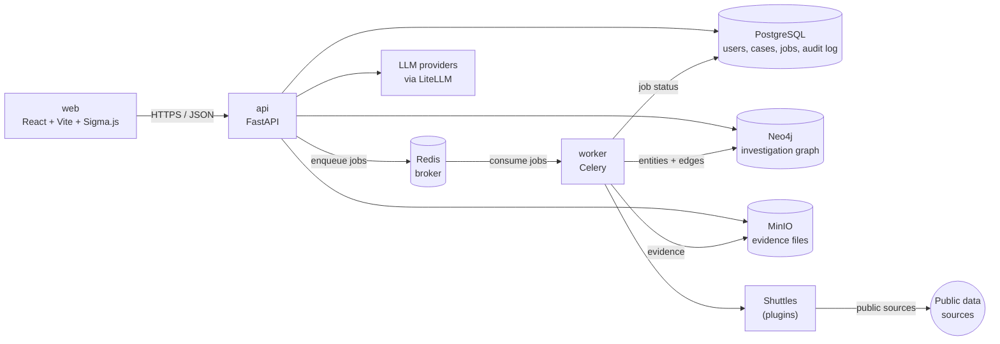

# Architecture

> **Status: planned.** Nothing here is implemented yet. This document describes the intended design and will change as the code lands.

## Components

| Component | Role |
| --- | --- |
| `apps/web` | React UI: graph view, case management, provenance panel |
| `apps/api` | FastAPI: auth, cases, graph queries, job submission, AI endpoints |
| `apps/worker` | Celery workers that run Shuttles and auto-pivot scans |
| `packages/sdk` | Shuttle SDK: base classes, entity types, test helpers |
| `shuttles/` | Built-in Shuttles |
| PostgreSQL | Users, cases, jobs, audit log, encrypted API keys |
| Neo4j | Entities and relationships |
| Redis | Celery broker, rate-limit counters, result cache |
| MinIO | Evidence files (screenshots, raw responses, documents) |

## Data model

Entity types are inspired by STIX 2.1:

| Group | Types |
| --- | --- |
| Infrastructure | Domain, Subdomain, IP, ASN, Netblock, Certificate, URL, Port/Service, Technology |
| Organizations and people | Organization, Person, Email, Username, SocialProfile, Phone |
| Other | Breach, Location, Image, Document, CryptoWallet |

### Provenance

Every node **and** edge carries:

| Field | Meaning |
| --- | --- |
| `source` | The Shuttle that produced it |
| `first_seen` / `last_seen` | When it was first and most recently observed |
| `confidence` | 0–1 |
| `admiralty` | Admiralty rating, `A1`–`F6` (source reliability × information credibility) |
| `evidence` | Pointer to the evidence object in MinIO |
| `case_id` | The case it belongs to |

### Deduplication

Each entity type defines a **canonical key** (e.g. lower-cased FQDN for a Domain, normalized address for an IP). Writes are upserts on `(case_id, type, canonical_key)`, so the same entity found by several Shuttles becomes one node with multiple provenance records.

## Shuttle contract

A Shuttle is a plugin that takes one entity and returns entities and edges. Each declares:

| Field | Description |
| --- | --- |
| `name` | Unique identifier |
| `input_types` | Entity types it accepts |
| `output_types` | Entity types it can produce |
| `mode` | `passive` (third-party sources only) or `active` (touches the target) |
| `requires_api_key` | Whether a user-supplied key is needed |
| `rate_limit` | Per-source request limit |
| `risk_level` | `infrastructure` or `person` |

Active Shuttles run only against assets with verified ownership. Person-related Shuttles are gated per case and never run during auto-pivot.

## Auto-pivot

Auto-pivot expands a seed entity breadth-first:

- **Max depth** — number of hops from the seed
- **Budget** — maximum requests and/or nodes per scan
- **Entity-type allowlist** — only pivot through selected types
- **Passive-only mode** — skip all active Shuttles
- Person-related Shuttles are always excluded

The scan stops when the queue is empty or any limit is reached; partial results are kept.

## AI layer

- **LiteLLM** provides one interface to any provider, including local models via Ollama.
- **Per-user API keys** — encrypted at rest with AES-GCM, bound to the owning `user_id` (as associated data), decrypted only server-side when needed, and **never sent to the browser**.
- **Per-feature model routing** — each user picks which model handles each feature (e.g. summaries vs. query generation).
- **Natural language → Cypher** — generated queries run as a **read-only** Neo4j user, so the AI can never modify the graph.

## Guardrails

Collection rules, gated Shuttles, audit logging, PII redaction and data retention are defined in [ETHICS.md](../ETHICS.md). They are design requirements, not optional features.
