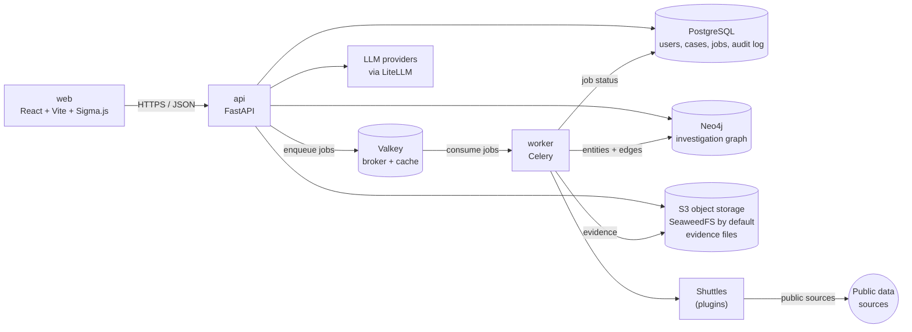

# Architecture

> **Status: planned.** Nothing here is implemented yet. This document describes the intended design and will change as the code lands.

## Components

| Component | Role |
| --- | --- |
| `apps/web` | React UI: graph view, case management, provenance panel |
| `apps/api` | FastAPI: auth, cases, graph queries, job submission, AI endpoints |
| `apps/worker` | Celery workers that run Shuttles and auto-pivot scans |
| `packages/sdk` | Shuttle SDK: base classes, entity types, test helpers |
| `shuttles/` | Built-in Shuttles |
| PostgreSQL | Users, cases, jobs, audit log, encrypted API keys |
| Neo4j | Entities and relationships |
| Valkey (Redis-compatible) | Celery broker, rate-limit counters, result cache |
| S3-compatible object storage (SeaweedFS by default) | Evidence files (screenshots, raw responses, documents) |

### Infrastructure choices

The local stack is defined in [`deploy/compose.yaml`](../deploy/compose.yaml) (see [Running the stack](../CONTRIBUTING.md#running-the-stack)).

- **Object storage is accessed only through the S3 API**, so any S3-compatible service works. The stack ships [SeaweedFS](https://github.com/seaweedfs/seaweedfs) (Apache-2.0) as the default. MinIO was the original plan, but its community edition no longer publishes Docker images and has been archived.
- **Valkey instead of Redis.** [Valkey](https://valkey.io/) is a BSD-licensed, Redis-compatible fork. Redis itself is no longer under a permissive open-source license. Clients talk the Redis protocol, so standard Redis libraries work unchanged.
- **Neo4j Community Edition** (GPLv3) runs as a separate server that Nightloom talks to over Bolt. It is not bundled into Nightloom's code.

### Web UI

[`apps/web`](../apps/web/) is a single-page app built with React, Vite and TypeScript (strict). The graph is a [graphology](https://graphology.github.io/) graph rendered by [Sigma.js](https://www.sigmajs.org/) (WebGL), laid out with ForceAtlas2 for a bounded number of iterations so the page never blocks on layout.

- **Same-origin API.** The UI only calls relative `/api/...` URLs. In development the Vite dev server proxies them to `http://127.0.0.1:8000`; in the Compose stack the `web` container (unprivileged nginx) serves the built files and proxies `/api/` to `http://api:8000`. No CORS configuration is needed.
- **Static hosting.** nginx falls back to `index.html` for client-side routes, caches the content-hashed `/assets/` for a year, revalidates `index.html` on every load, and sends a strict Content Security Policy (same origin only, plus `blob:` for workers and images) with other security headers.
- **API status.** Once signed in, the top bar polls `GET /api/v1/ready` every 15 seconds and shows *Ready*, *Degraded* (listing the failing checks) or *API offline*.
- **Sign-in.** See [Web authentication flow](#web-authentication-flow).
- **Demo data.** Until the graph API exists, the UI shows a typed fixture ([`src/demo/sampleGraph.ts`](../apps/web/src/demo/sampleGraph.ts)) shaped like the [data model](#data-model): entity types and provenance fields on every node and edge. It is entirely fictional (`example.org`, RFC 5737 IP addresses, RFC 5398 AS numbers, no people) and labelled "Demo data" in the UI.
- **Testable without WebGL.** Highlighting, filtering and search are pure functions over the graph; sigma only applies their results through its node and edge reducers.

### Health and readiness

The API creates its clients (async SQLAlchemy engine, Neo4j driver, Valkey client, S3 client) in the FastAPI lifespan, but none of them connects at startup. The API therefore always starts, even when every dependency is down.

| Endpoint | Kind | Behaviour |
| --- | --- | --- |
| `GET /api/v1/health` | Liveness | Always `200` while the process is serving requests. Never touches a dependency. |
| `GET /api/v1/ready` | Readiness | Pings PostgreSQL (`SELECT 1`), Neo4j (`RETURN 1`), Valkey (`PING`) and object storage (`HeadBucket` on the evidence bucket) concurrently, each limited to `NIGHTLOOM_DEPENDENCY_TIMEOUT_SECONDS` (default 2). `200` when all pass, `503` otherwise. |

The readiness body reports `ok`, `latency_ms` and a short `error` for each dependency. Errors are redacted before they are returned or logged: they never include credentials or connection URLs. Use `/health` for container restarts and `/ready` for traffic routing and monitoring.

### Authentication

The API authenticates browsers with **server-side sessions** (code in [`nightloom_api/auth/`](../apps/api/src/nightloom_api/auth/)). There is no public registration: the first admin is created with `make create-admin`, and admins create everyone else.

**Sessions.** A successful `POST /api/v1/auth/login` creates a random 256-bit token (`secrets.token_urlsafe(32)`) and sends it only in the `nightloom_session` cookie: `HttpOnly`, `SameSite=Strict`, `Path=/`, and `Secure` in production (or with `NIGHTLOOM_COOKIE_SECURE=true`). PostgreSQL stores only the token's SHA-256 in the `sessions` table, so a leaked table cannot be replayed. A session expires after **24 hours without use** (sliding; `last_seen_at` is written at most once a minute) and, at the latest, **7 days after sign-in**. Expired sessions are deleted when they are next presented and when their user signs in again. Logging out deletes the row. Changing your password signs out your other sessions; deactivating a user or revoking their sessions (admin) signs them out everywhere.

**CSRF.** Login also sets a non-HttpOnly `nightloom_csrf` cookie. Every authenticated `POST`, `PUT`, `PATCH` or `DELETE` must repeat it in the `X-CSRF-Token` header (double submit, constant-time comparison), or it gets `403`. The CSRF token is derived from the session token with a domain-separated SHA-256, so a cookie planted by an attacker (for example from a sibling subdomain) does not match the victim's session. Login itself is exempt. `SameSite=Strict` is a second, independent layer.

**Passwords.** Hashed with Argon2id ([pwdlib](https://github.com/frankie567/pwdlib) on argon2-cffi, its recommended parameters); a hash with outdated parameters is upgraded on the next successful sign-in. The policy is 12–128 characters, not equal to or containing the local part of the user's email (for local parts of three or more characters). Emails are stored trimmed and lower-case, and are unique.

**Roles.** `admin`, `analyst` and `viewer`. Routes use the `current_user` dependency (`401` without a valid session) and `require_role(...)` (`403`). Only admins manage users. An admin cannot demote or deactivate themselves, and the last active admin cannot be demoted or deactivated (`409`); concurrent changes are serialized with row locks.

**Brute-force protection.** Failed sign-ins are counted in Valkey, per email (hashed, so Valkey holds no addresses) and per client IP, in 15-minute windows. After **5 failures for an email** or **20 from an IP**, further attempts get `429` with `Retry-After` until the window ends, without checking the password. A successful sign-in resets the email's counter. Every failure returns the same `401 "Invalid email or password."`, and an unknown email still runs a full Argon2 verification, so neither the message nor the timing reveals whether an account exists. Wrong current passwords on `POST /auth/password` count against the same limits. If Valkey is unreachable, sign-in fails closed with `503`.

| Endpoint (under `/api/v1`) | Who | Notes |
| --- | --- | --- |
| `POST /auth/login` | anyone | `{email, password}` → `{user}` and both cookies |
| `POST /auth/logout` | signed in | `204`, clears the cookies |
| `GET /auth/me` | signed in | the current user |
| `POST /auth/password` | signed in | `{current_password, new_password}` → `204` |
| `GET /users`, `POST /users` | admin | list; create with an initial password |
| `PATCH /users/{id}` | admin | `display_name`, `role`, `is_active` |
| `DELETE /users/{id}/sessions` | admin | sign the user out everywhere |

`/health` and `/ready` stay public. Request validation errors (`422`) never echo the submitted values, so a password cannot be reflected back.

**Why not JWT?** The browser is the only client, and it talks to the API on the same origin. Opaque session tokens checked against PostgreSQL can be revoked instantly (logout, password change, deactivation, admin revocation) and reflect role changes on the next request; a stateless JWT stays valid until it expires unless a server-side denylist is added, which brings back the database lookup without the simplicity. Keeping the token in an HttpOnly cookie also keeps it away from page scripts, whereas a bearer token readable by JavaScript is exposed to any XSS.

**Production safety.** With `NIGHTLOOM_ENV=production`, the API refuses to start while `NIGHTLOOM_DATABASE_URL`, `NIGHTLOOM_NEO4J_PASSWORD`, `NIGHTLOOM_VALKEY_URL`, `NIGHTLOOM_S3_ACCESS_KEY` or `NIGHTLOOM_S3_SECRET_KEY` still contains the `change-me` placeholder. The error names the variables, never their values.

**Hashing off the event loop.** An Argon2 check costs roughly a tenth of a second of CPU. Request handlers never run it on the event loop: `passwords.*_async` hand it to a worker thread, and a shared limiter lets at most `NIGHTLOOM_PASSWORD_HASH_CONCURRENCY` (default 4, at least 1) hashes run at once. Other requests stay responsive during a burst of sign-ins, and a sign-in flood queues for hashing instead of taking every worker thread and CPU core. The CLI keeps the synchronous functions.

**Client IP behind the proxy.** The per-IP limit and each session's recorded `ip` use the client's address. In the Compose stack the browser talks to nginx (`web`), which forwards `/api/` with `X-Real-IP: $remote_addr` and `X-Forwarded-For: $proxy_add_x_forwarded_for` (the client's header with the peer nginx saw appended). uvicorn (`--proxy-headers`) honours forwarding headers only from the addresses in `FORWARDED_ALLOW_IPS`; Compose sets that to exactly the `web` container's address, which is fixed (`NIGHTLOOM_WEB_IP`, default `172.30.0.10`, on the fixed subnet `NIGHTLOOM_NETWORK_SUBNET`, default `172.30.0.0/24`). Docker hands out addresses to every other container only from `NIGHTLOOM_NETWORK_IP_RANGE` (default `172.30.0.128/25`), which excludes the web address, so no other container can ever hold the trusted address, for example after `web` is recreated. uvicorn then takes the right-most address in `X-Forwarded-For` that is not a trusted proxy, which is the one nginx appended, so a value the client forges at the front of the header never wins. Requests that reach the API directly (port 8000) come from an untrusted peer, so their forwarding headers are ignored and the peer address is used. `FORWARDED_ALLOW_IPS` is never `*`: that would let any client choose its own IP and dodge the per-IP limit. Outside Compose, uvicorn's default trusts only `127.0.0.1`; set `FORWARDED_ALLOW_IPS` to your proxy's address when you put another one in front.

**Accepted trade-off: email lockout.** Five failed attempts lock an email for the rest of its 15-minute window, whoever made them. Someone who knows a user's email can therefore keep that user from signing in by sending wrong passwords, for at most 15 minutes per five attempts, and must keep doing so to extend it. This is accepted because the per-email limit is the main protection against password guessing spread across many IPs, which the per-IP limit alone cannot stop; the window bounds the harm, and the lock clears by itself when it ends.

### Web authentication flow

The web UI ([`apps/web/src/auth/`](../apps/web/src/auth/), [`src/api/client.ts`](../apps/web/src/api/client.ts)) never sees the session token: it lives only in the `HttpOnly` cookie, which the browser sends on every same-origin request (`credentials: "same-origin"`).

- **Start-up.** `AuthProvider` asks `GET /auth/me`. Until it answers, a splash screen is shown (no flash of the sign-in form); `200` shows the app, anything else the sign-in screen.
- **Sign-in.** The form posts to `/auth/login`. The UI shows only fixed messages: *Invalid email or password.* for `401`, *Too many attempts. Try again in N minutes.* for `429` (from `Retry-After`, rounded up), and generic network, timeout and unavailable messages. Server text is never shown, except validation messages (`422`).
- **CSRF.** For every `POST`, `PUT`, `PATCH` and `DELETE` the client reads the `nightloom_csrf` cookie and repeats it in the `X-CSRF-Token` header; `GET` requests carry no header.
- **Session expiry.** A `401` on any request other than sign-in means the session ended (expired, revoked by an admin, or signed out by a password change elsewhere). The client notifies `AuthProvider`, which drops the user and shows the sign-in screen with *Your session has ended. Please sign in again.*
- **Sign-out.** Calls `POST /auth/logout`, then clears the local state even if that call fails; an orphaned server session still expires on its own.
- **Password change.** A modal checks the policy locally (12–128 characters, confirmation matches, differs from the current one), then posts to `/auth/password`; the server checks again, and its validation messages are shown next to the fields. On success the other sessions are signed out and this one stays.

### Migrations

The PostgreSQL schema is managed by [Alembic](https://alembic.sqlalchemy.org/) in [`apps/api/alembic/`](../apps/api/alembic/). ORM models derive from `nightloom_api.infra.db.Base`, whose metadata has an explicit naming convention, so constraint and index names are stable across autogenerated revisions. The history starts at an empty `0001_baseline` revision; `0002_users_sessions` adds the `users` and `sessions` tables and the `user_role` enum. In the Compose stack, a one-shot `migrate` service runs `alembic upgrade head` before the API starts.

## Data model

Entity types are inspired by STIX 2.1:

| Group | Types |
| --- | --- |
| Infrastructure | Domain, Subdomain, IP, ASN, Netblock, Certificate, URL, Port/Service, Technology |
| Organizations and people | Organization, Person, Email, Username, SocialProfile, Phone |
| Other | Breach, Location, Image, Document, CryptoWallet |

### Provenance

Every node **and** edge carries:

| Field | Meaning |
| --- | --- |
| `source` | The Shuttle that produced it |
| `first_seen` / `last_seen` | When it was first and most recently observed |
| `confidence` | 0–1 |
| `admiralty` | Admiralty rating, `A1`–`F6` (source reliability × information credibility) |
| `evidence` | Pointer to the evidence object in S3 object storage |
| `case_id` | The case it belongs to |

### Deduplication

Each entity type defines a **canonical key** (e.g. lower-cased FQDN for a Domain, normalized address for an IP). Writes are upserts on `(case_id, type, canonical_key)`, so the same entity found by several Shuttles becomes one node with multiple provenance records.

## Shuttle contract

A Shuttle is a plugin that takes one entity and returns entities and edges. Each declares:

| Field | Description |
| --- | --- |
| `name` | Unique identifier |
| `input_types` | Entity types it accepts |
| `output_types` | Entity types it can produce |
| `mode` | `passive` (third-party sources only) or `active` (touches the target) |
| `requires_api_key` | Whether a user-supplied key is needed |
| `rate_limit` | Per-source request limit |
| `risk_level` | `infrastructure` or `person` |

Active Shuttles run only against assets with verified ownership. Person-related Shuttles are gated per case and never run during auto-pivot.

## Auto-pivot

Auto-pivot expands a seed entity breadth-first:

- **Max depth** — number of hops from the seed
- **Budget** — maximum requests and/or nodes per scan
- **Entity-type allowlist** — only pivot through selected types
- **Passive-only mode** — skip all active Shuttles
- Person-related Shuttles are always excluded

The scan stops when the queue is empty or any limit is reached; partial results are kept.

## AI layer

- **LiteLLM** provides one interface to any provider, including local models via Ollama.
- **Per-user API keys** — encrypted at rest with AES-GCM, bound to the owning `user_id` (as associated data), decrypted only server-side when needed, and **never sent to the browser**.
- **Per-feature model routing** — each user picks which model handles each feature (e.g. summaries vs. query generation).
- **Natural language → Cypher** — generated queries run as a **read-only** Neo4j user, so the AI can never modify the graph.

## Guardrails

Collection rules, gated Shuttles, audit logging, PII redaction and data retention are defined in [ETHICS.md](../ETHICS.md). They are design requirements, not optional features.
